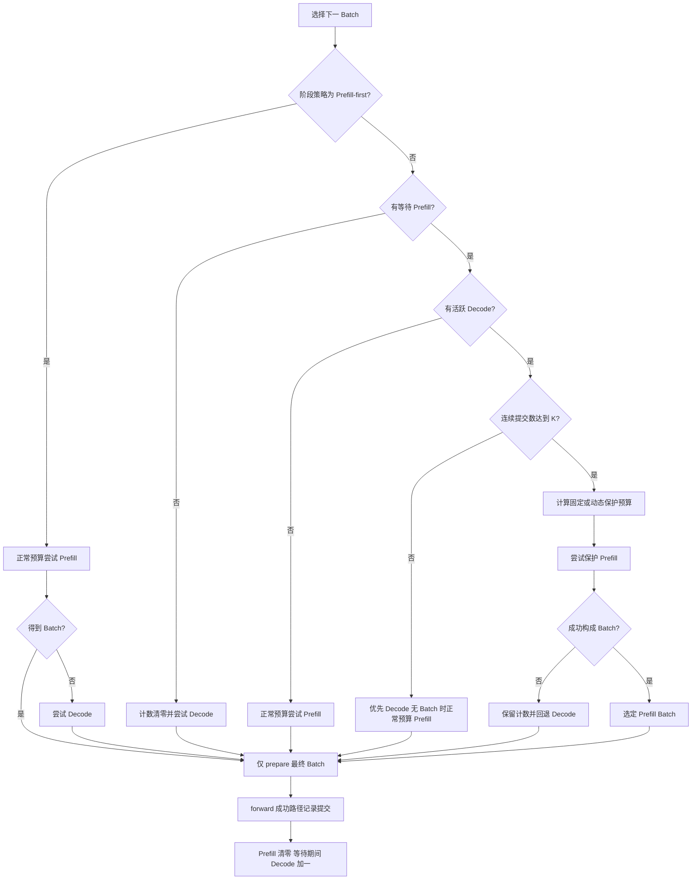
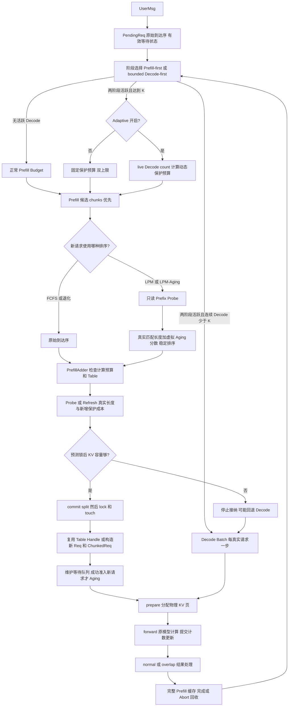

# mini-SGLang 四项调度与缓存优化审计

审计日期：2026-10-13。仓库：`Serving_V1/Promotion/mini-sglang`。本报告以当前工作区源码为准；本次只新增审计文档，不修改业务代码、不提交 Commit、不 push。

配套交付：[简历描述](mini_sglang_four_optimizations_resume.md)、[面试准备](mini_sglang_four_optimizations_interview.md)、[A/B Benchmark 方案](mini_sglang_four_optimizations_benchmark_plan.md)。

## 总体结论与证据范围

四项功能已形成两层调度和一个缓存准入流程：阶段层选择 Prefill 或 Decode，Prefill 层排序待首次准入请求，缓存层用只读计划检查容量后提交匹配。动态预算只用于有 Decode 竞争时的保护性 Prefill。默认配置仍为 `prefill-first + fcfs + Aging=0 + adaptive=False`。[配置：SchedulerConfig][config]

这里的默认兼容指排序、阶段选择和预算含义的兼容：两阶段准入默认也会运行，刻意改变了旧路径被拒请求的 split/LRU 副作用，不能声称所有缓存内部状态与HEAD逐项完全相同。

| 优化 | 当前实现 | 已验证范围 | 不能据此声称 |
|---|---|---|---|
| Radix 两阶段匹配 | probe/refresh → 容量预测 → split → lock → touch | 拒绝无缓存副作用；实际匹配长度、保护成本；计划失效处理；page_size=1/4 | 所有分页容量边界安全；并发事务安全；完全消除树遍历 |
| FCFS / LPM / LPM-Aging | 稳定到达序、只读排序、有效准入轮 Aging、两种 FCFS 退化 | 排序、老化阈值、计数、队列移除、chunk、Abort、默认兼容 | HRRN 或按秒老化；严格服务时延保证；GPU 吞吐提升 |
| Decode-first-bounded | 等待期间累计 Decode Batch 提交；达到 K 尝试小预算 Prefill | 边界、失败保持计数、normal/overlap CPU 生命周期 | K 是时间上限；K 后一定准入；Decode 抢占或显存预留 |
| Adaptive Chunk Budget | 根据活跃 Decode 数计算保护预算，默认关闭 | 公式、上下界、动态负载、chunk 和资源限制、CLI 校验 | Sarathi 混合 Batch；GPU TPOT 改善已测得；自动寻优 |

已有及本次 CPU 回归均为 **249 项通过**；本次最终测试记录见“测试与证据汇总”。历史 Benchmark 共保存 2,500 次模型外模拟运行，不能解释为 2,500 次 GPU 推理。本次额外复现发现 **page_size>1、多个短请求的 Token 准入与物理页需求可能不一致**；固定和动态保护预算都能触发。问题详见“审计发现”，本次没有修复。

### 历史归因

- `HEAD = 9a91cfafe754aa85daee49998176275667eb58f2`，最近提交是稳定 TP rank 间 Decode 请求排序。四项优化不对应四个独立 Commit，属于未提交工作区改动。
- 当前相对 HEAD 的 tracked diff 涉及 13 个文件，687 行新增、72 行删除；其中含既有注释、消息/core 改动，不能全部归因为这四项功能。新增 tests、benchmarks、docs、artifacts 也未提交。
- HEAD 可可靠还原原始 `_tree_walk`、双重准入检查、FCFS 队列和 Prefill-first 表达式。`ba3b55c` 已修改上游 split 后时间戳，不能把 Radix 基础能力或 Decode uid 排序当成本次创新。
- [LPM 阶段差异](../artifacts/lpm_aging/changes.diff) 的 before 已包含早期只读 probe、延迟 split 和 FCFS 退化，不能将该 diff 当作最原始 Radix 基线。[阶段策略差异](../artifacts/batch_scheduling/changes.diff) 和 [动态预算差异](../artifacts/adaptive_prefill_budget/changes.diff) 则记录各自执行前工作区与执行后的变化。
- 中断前的 `/tmp` 原始快照在恢复环境中已不可访问；上述仓库内 diff、JSON、XML 仍存在。没有依靠丢失的快照编造历史。下文 Before 均标明 HEAD 或阶段差异来源。

复核历史的只读命令：

```bash
git status --short
git log -8 --oneline
git diff --stat
git show HEAD:python/minisgl/kvcache/radix_cache.py
git show HEAD:python/minisgl/scheduler/prefill.py
git show HEAD:python/minisgl/scheduler/scheduler.py
```

### 全局调用链与原有约束

```text
normal_loop / overlap_loop
  → _process_one_msg(UserMsg)：限制上下文和 max_tokens
  → PrefillManager.add_one_req：创建 PendingReq，追加原始队列
  → _schedule_next_batch → _select_next_batch：选择一个阶段、一个 Batch
    → Prefill：正常预算或保护预算
      → schedule_next_batch → _get_candidates：chunks 优先，新请求排序
      → PrefillAdder.try_add_one
        → 新请求：检查 Table 槽 → probe/refresh → KV 准入 → commit/lock/touch
                   → 占用 Table、复制前缀索引、构造 Req 或 ChunkedReq
        → 已准入 chunk：复用 Handle/Table/真实 cached_len
      → 按对象身份移除成功项、保存 chunk、统一增加有效等待计数
    → Decode：活跃 running_reqs 按 uid 构成 Decode Batch
  → _prepare_batch：分配本轮物理 KV 页、positions、Attention/Sampling 元数据
  → _forward：Engine 提交、写 Token Pool、更新 Decode 集合、记录提交计数
  → _process_last_data：处理输出；完成/Abort 时归还 Table 和 Cache 引用
```

源码定位：[`Scheduler._process_one_msg` L243][message]、[`add_one_req` L153][arrival]、[`_select_next_batch` L311][stage]、[`schedule_next_batch` L213][prefill-run]、[`try_add_one` L108][adder]、[`DecodeManager.schedule_next_batch` L32][decode]、[`_prepare_batch` L284][prepare]、[`_forward` L353][forward]、[`_process_last_data` L188][results]。

`Batch.phase` 仍只有 Prefill/Decode；一次阶段选择可以包含多个请求，Prefill 每个请求可运行一个 chunk，Decode 每个真实请求推进一个 Token。Decode Batch 的请求数来自活跃集合，随准入、完成和 Abort 改变，并非固定大小；这与 GPU 图的 dummy padding 数不同。[DecodeManager][decode]、[Req / Batch][core]

原有隐含约束仍保留：chunk 先续算；一个候选不能接纳就 `break`；Prefill 计算预算按未缓存 Token 扣减；新请求 KV 准入预留完整剩余 Prompt 和最大输出；Table 槽位限制同时活跃请求；阶段选择、匹配提交和加引用在当前调度器中串行执行。以上约束不能从“排序更靠前”推导出“一定能服务”。[PrefillAdder][adder]、[PrefillManager][prefill-run]、[CacheManager.try_match_and_lock][admit]

## 优化一：Radix Prefix Cache 两阶段匹配

### 1. 优化背景

HEAD 中 `PrefillAdder._try_allocate_one` 先执行 `match_req → match_prefix → _tree_walk`，之后才检查 KV 容量。HEAD 的 `_tree_walk` 会更新访问节点时间戳，部分命中还会 `split_at`。即使随后请求因 KV 容量被拒绝，缓存树结构和 LRU 已发生变化；第二次检查失败只能 unlock，无法撤销 split 或 LRU 更新。历史证据为 HEAD `prefill.py:L39–54` 与 `radix_cache.py:L205–229`，可用上文 `git show` 命令复核。

在 LPM 排序中若对全部等待请求直接调用旧匹配，这种副作用还会扩散到本轮未获接纳的请求。优化目的因此是把“估算匹配”和“采用前缀”分开，避免无效调度改变缓存，而非重新实现 RadixAttention。

### 2. 具体修改文件

| 文件路径 | 类/函数 | 修改内容 | 修改目的 | 证据 |
|---|---|---|---|---|
| `python/minisgl/kvcache/base.py` | MatchProbe、BasePrefixCache | 增加 probe/refresh/commit 接口、保护成本字段 | 把只读计划和提交分开 | [L67 / L75 / L87][base-probe] |
| `python/minisgl/kvcache/radix_cache.py` | RadixMatchProbe、probe_prefix、refresh_probe、commit_match | 保存末节点、节点内匹配量、结构版本；按页对齐；失效刷新；提交时才 split | 保持匹配真实性并推迟副作用 | [L106][radix-plan]、[L175][probe]、[L204][refresh]、[L222][commit] |
| 同上 | _tree_walk、_touch_path、insert_prefix、evict | 遍历不再 touch；采用/插入路径单独 touch；结构变化递增版本 | 控制 LRU 与计划失效 | [L149][touch]、[L232][insert]、[L259][evict]、[L320][walk] |
| `python/minisgl/kvcache/naive_cache.py` | NaivePrefixCache | probe 返回长度/成本 0，commit 返回空 Handle | 保持无前缀缓存实现兼容 | [L26][naive] |
| `python/minisgl/scheduler/cache.py` | probe_req、try_match_and_lock、estimate_req、touch | 排除最后一个 Prompt Token；预测锁后容量；提交后 lock/touch | 保留容量含义，延迟 split 与 LRU | [L35 / L40][admit] |
| `python/minisgl/scheduler/prefill.py` | PrefillAdder._try_allocate_one、match_probes | 接受排序阶段计划；先 Table 检查再提交 | 不做第二轮无条件 Token 比较 | [L48 / L50][adder] |
| `tests/core/test_prefill_admission.py` | rejection / partial / locking cost / one comparison | 验证拒绝快照、实际保护增量和 Token 比较次数 | 检查两阶段语义 | [L58][test-admission] |
| `tests/core/test_prefill_policy.py` | readonly / stale / ref-count / split invalidation | 比较 probe 与真实长度；结构变化重探测 | 检查排序计划复用 | [L312][test-probe] |
| `docs/lpm_aging.md`、`artifacts/lpm_aging/` | 只读匹配说明、测试和差异记录 | 与排序共用缓存计划 | 留存工程证据 | [既有文档](lpm_aging.md)、[阶段 diff](../artifacts/lpm_aging/changes.diff) |

### 3. Before / After

```python
# Before：HEAD 的真实逻辑，省略复制代码
handle = cache.match_req(req).cuda_handle    # 匹配已可能 split + touch
required = input_len - handle.cached_len + output_len + reserved_size
if required > cache.available_size:
    return None
cache.lock(handle)
if required > cache.available_size:
    return cache.unlock(handle)

# After：CacheManager.try_match_and_lock 的真实逻辑
probe = cache.probe_req(req) if probe is None else prefix.refresh_probe(probe, ids_without_last)
required = input_len - probe.cached_len + output_len + reserved_size
available_after_lock = cache.available_size - probe.newly_protected_size
if required > available_after_lock:
    return None
handle = prefix.commit_match(probe)
cache.lock(handle)
cache.touch(handle)
```

两次检查并未简单删除：新的只读预测使用**锁后的可用容量**，在串行不变状态下等价于旧后锁检查，而且比未扣保护成本的旧前锁检查更严格，因此不必再先执行一个更宽松的检查。[try_match_and_lock:L40][admit]

需要精确区分 API：**`RadixPrefixCache.commit_match` 只 split 并返回 Handle，不负责 lock/touch；后两步由 CacheManager 完成。**采用发生在 Prefill 准入阶段，尚未实际运行 GPU，也不意味着整个 `_prepare_batch → _forward` 是事务。[BasePrefixCache.commit_match:L87][base-probe]、[Radix.commit_match:L222][commit]

### 4. 完整调用链

`UserMsg → _process_one_msg → add_one_req → _select_next_batch(Prefill) → schedule_next_batch → _get_candidates(可选排序 probe) → PrefillAdder.try_add_one → _try_allocate_one(Table 检查) → CacheManager.try_match_and_lock → probe_req/refresh_probe → required 与 available_after_lock 比较 → commit_match → lock → touch → Table 分配/前缀索引复制 → Req/ChunkedReq → _prepare_batch.allocate_paged → _forward → cache_req/结束或 Abort 回收`。

FCFS 无排序计划时只在尝试准入该请求时 probe；LPM 提前生成的计划通过本轮局部字典 `match_probes[id(req)]` 传递，准入用 `pop` 取出，不维护长期请求计划表。[候选计划 L196][prefill-sort]、[PrefillAdder L55][adder]

### 5. 核心代码解析

| 字段/步骤 | 实际语义 |
|---|---|
| `cached_len` | 可复用长度，按页向下对齐；匹配输入不含 Prompt 最后一个 Token |
| `newly_protected_size` | 匹配路径中当前 ref_count=0、加引用后将变为不可淘汰的 Token 数；部分节点只计命中部分 |
| `node / matched_in_node` | 末节点与节点内命中长度；提交可直接定位 split，不再从 root 做 Token 比较 |
| `structure_version` | 插入新节点、split、evict 时递增；结构版本变动重新 probe |
| `refresh_probe` | 同版本仅沿父链重算保护成本，解决其他请求 lock/unlock 后成本变化；不同版本重新比较 Token |
| `available_size` | `free_pages * page_size + evictable_size`，受保护前缀不计入可用容量 |
| lock/unlock | 节点 ref_count 增减；0↔1 转换调整 evictable/protected Token 计数 |
| touch | 采用前缀后沿父链更新时间戳；插入前缀也更新路径，以配合叶子向父节点递进的 LRU 淘汰 |

依据：[probe:L175][probe]、[refresh:L204][refresh]、[commit:L222][commit]、[lock:L126][lock]、[touch:L149][touch]、[available_size:L68][admit]。

只读性来自 probe 仅查找 children、比较 key、计算局部整数并返回 frozen dataclass；不会调用 split/lock/touch、改 children/parent/ref_count/timestamp 或缓存容量。为排序写入 `PendingReq.cached_len_est` 是请求侧估算字段变化，不是缓存变化。[probe][probe]、[PendingReq:L15][pending]

“避免重复匹配”有条件：树版本不变时，排序 probe 可复用，commit 不比较 Token；但 refresh、lock、touch、`get_matched_indices`、unlock 仍分别遍历父链。一次接受 partial match 的 split 会使本轮其他旧计划版本失效，之后仍可能再次 probe；全局版本甚至会让不相交分支的计划重新探测。[refresh][refresh]、[get_matched_indices:L96][radix-plan]、[split 失效测试 L465][test-invalidate]

### 6. 正确性与测试

`test_prefill_admission.py` 覆盖 page_size=1/4 下 Table/KV 拒绝时树结构、timestamp、ref_count、容量不变；部分命中采纳后才 split/lock/touch；已保护祖先不重复扣减；预测保护成本与实际变化一致；一次准入每条匹配边只比较一次。[L58/L82/L110/L136/L166][test-admission]

`test_prefill_policy.py` 覆盖部分/无匹配/重复前缀的只读估算；insert/evict 后重新确认；仅 ref_count 变化时重算成本而不比较 Token；同一前缀的计划复用；unlock、split 后的成本/结构刷新。[L312–381][test-probe]、[L451–465][test-invalidate]。这些测试已包含在本次 CPU 回归。

已有资源测试能证明所覆盖场景正常回收，**不能覆盖所有 page_size>1 的紧容量组合**。本次新复现失败见审计发现。`RadixPrefixCache.check_integrity()` 仍是 `pass`；CacheManager 常规检查主要是页总数/对齐，Benchmark 另外检查页与 Table 的唯一性和引用归还。[Radix L300][radix-integrity]、[CacheManager L127][cache-integrity]、[Benchmark.assert_resources:L144][bench-resources]

### 7. 性能收益与代价

| 指标 | 合理预期 / 已有证据 | 当前不能确认 |
|---|---|---|
| TTFT | 减少被拒请求无效树变更与后续维护；可复用排序计划 | GPU TTFT 改善幅度 |
| TPOT / ITL | 可能减少 CPU 调度干扰 | 真实 Decode 输出间隔变好 |
| Throughput | 可能减少重复 Token 比较；commit 无 Token 比较已测试 | 服务吞吐收益；两阶段独立 A/B 尚缺 |
| KV utilization | 拒绝不锁住前缀、不污染 LRU；保护成本正确计入 | 命中率/显存占用提高比例 |
| Scheduler overhead | 新增 probe 对象和保护成本刷新；父链工作仍存在 | 相对 HEAD 的完整端到端 CPU 净收益 |
| Fairness | 为无副作用 LPM/Aging 提供基础 | 本机制自身提供公平性保证 |

当前无独立的“旧匹配 vs 两阶段”计时实验；LPM 排序微基准不能归为这一优化的独立收益。[Benchmark 方法](../artifacts/lpm_aging/benchmark.json)

### 8. 局限性与潜在问题

串行 refresh→commit→lock 是实现前提，版本号不是互斥锁，也没有跨线程事务保证。传入 probe 必须对应同一输入；同版本刷新不会重新校验输入内容。旧 `match_prefix`/`_tree_walk` 接口仍可 split，只是不再 touch，外部调用它不能视为只读。[admit][admit]、[refresh][refresh]、[match_prefix:L164][touch]、[walk:L320][walk]

成功匹配提交后若 Table 复制、物理页分配或 forward 失败，没有通用的准入回滚。最终物理页舍入缺口见后文，不能把“预测了锁后容量”扩展成“整个请求生命周期一定容量安全”。

## 优化二：FCFS / LPM / LPM + Pass-based Aging

### 1. 优化背景

HEAD 的 PrefillManager 按 `pending_list` 顺序尝试准入，没有前缀排序；已运行但未完成的 chunk 放回队首。纯 FCFS 可能延迟 cache-hot 请求，纯 LPM 则可能让 cache-cold 请求被连续新 hot 请求越过。优化在原有准入资源约束之上选择顺序，同时保留默认 FCFS。HEAD 历史定位为 `prefill.py:L123–150`；当前实现见 [PrefillManager:L133][prefill-sort]。

### 2. 具体修改文件

| 文件路径 | 类/函数 | 修改内容 | 修改目的 | 证据 |
|---|---|---|---|---|
| `python/minisgl/scheduler/utils.py` | PendingReq、validate_prefill_policy | 到达序、原始等待步、估算长度、有效等待轮；策略校验 | 请求本身承载排序状态 | [L15 / L34][pending] |
| `python/minisgl/scheduler/prefill.py` | add_one_req、_get_candidates、schedule_next_batch | chunk 分区优先；只读候选排序；FCFS 退化；按身份移除；一次有效轮加一 | 同时保持公平与队列正确性 | [L153][arrival]、[L165][prefill-sort]、[L213][prefill-run] |
| `python/minisgl/scheduler/cache.py`、`kvcache/base.py`、`kvcache/radix_cache.py` | probe_req、refresh_probe、MatchProbe | 排序与准入共享可刷新计划 | 减少无条件双遍历和副作用 | [admit][admit]、[refresh][refresh] |
| `python/minisgl/scheduler/config.py` | SchedulerConfig | 三策略、N、队列阈值、可选等待退化 | 默认行为兼容 | [L21–24][config] |
| `python/minisgl/scheduler/scheduler.py` | Scheduler.__init__ | 向 PrefillManager 传四项排序配置 | 遵循现有配置链 | [L63][scheduler-init] |
| `python/minisgl/server/args.py` | parse_args | 四项 CLI 参数和正/非负整数解析 | 对外可选 | [L270][cli-prefill] |
| `tests/core/test_prefill_policy.py`、`test_prefill_benchmark.py` | 排序、计数、生命周期、模拟排空 | 校验 N=0、同分、持续 hot、FCFS 降级、默认回归 | 语义与资源验证 | [L94][test-order]、[Benchmark 测试](../tests/core/test_prefill_benchmark.py) |
| `benchmarks/bench_prefill_policy.py`、`docs/lpm_aging.md`、`artifacts/lpm_aging/` | 排序微基准、混合负载模拟、差异/XML/JSON | 记录 CPU 成本与冷请求等待轮次 | 可复现 | [microbenchmark:L84][bench-prefill]、[既有文档](lpm_aging.md) |

### 3. Before / After

```python
# Before：HEAD，列表顺序即候选顺序
for req in pending_list:
    if cannot_add(req):
        break
pending_list = selected_chunks + pending_list[len(selected):]

# After：当前实现的精简逻辑
chunks, new = partition_by_chunk_state(pending_list)
if fcfs or len(new) > threshold or len(new) < 2 or no_new_admission_opportunity:
    candidates = chunks + new
elif any_raw_wait_threshold_reached:
    candidates = chunks + new
else:
    probes = readonly_probe_each(new)
    N = config_N if policy == 'lpm-aging' else 0
    candidates = chunks + sorted(new, key=lambda r: (-(r.cached_len_est + N*r.waiting_passes), r.arrival_order))
selected = try_admit_until_first_failure(candidates)
pending_list = selected_chunks + original_requests_not_selected_by_identity
if admitted_at_least_one_new and policy == 'lpm-aging' and N > 0:
    increment_once_for_remaining_unadmitted_new_requests()
```

默认路径保持原 FCFS 到达/续算行为；按身份移除是重排后的必要修正，否则按数量切片可能删错请求。[候选 L165][prefill-sort]、[移除/计数 L254][prefill-run]

### 4. 完整调用链

`UserMsg → Scheduler._process_one_msg → add_one_req(赋 arrival_order/arrival_step，waiting_passes 默认 0) → Scheduler 选 Prefill → schedule_next_batch(非空 raw step 加一) → _get_candidates(分离 chunks/new；判断退化；probe；打分排序) → PrefillAdder(用真实缓存长度准入) → 保存 selected/chunks → 按身份重建队列 → 未准入的新请求统一有效等待加一 → _prepare_batch/_forward → 完成或 Abort 移除状态`。[arrival][arrival]、[pending][pending]、[prefill-run][prefill-run]

### 5. 核心代码解析

| 配置/状态 | 默认值 | 生效条件与真实含义 |
|---|---:|---|
| `schedule_policy` | `fcfs` | 可选 `fcfs`、`lpm`、`lpm-aging`；与 Prefill/Decode 阶段策略独立 |
| `lpm_aging_tokens_per_pass` | 0 | N 为全局固定配置权重；仅 lpm-aging 且 N>0 时使用和更新计数 |
| `lpm_queue_threshold` | 128 | 待首次准入 new 请求数量 **>128** 才退化，128 仍可 LPM；不把 chunks 算入该数量 |
| `fairness_max_wait_steps` | 0 | 可选额外 FCFS 退化；任一 new 的 raw Prefill 调度步等待达到阈值时整轮退化；0 关闭 |
| `arrival_order` | 首个 0、单调递增 | 永久到达序，同分较早者优先；add 只追加，不每次入队排序 |
| `arrival_step / schedule_step` | 0 | 等待阈值使用；非空 schedule_next_batch 调用加一，包括零预算/失败尝试；不是秒数 |
| `waiting_passes` | 0 | 成功准入至少一个新请求后，本轮仍未准入 new 加一；一次 Batch 多个新请求也只加一 |
| `cached_len_est` | 0 | 本轮排序用只读估算；实际 Handle 长度仍由准入时刷新后的计划确定 |

依据：[SchedulerConfig][config]、[PendingReq / 校验][pending]、[候选逻辑][prefill-sort]、[计数逻辑][prefill-run]。

有效等待增长事件是**其他新请求的准入成功**，不是 Engine 完成。仅排序、空队列、零预算、全拒绝、Decode-only、chunk-only 不增长；chunk 即使首次准入时占了很小片段，也是一次新请求准入，随后续算不再累计。队列 FCFS 退化并不禁用 N>0 时的有效计数。[L239–262][prefill-run]

没有显式的“准入后 waiting_passes 清零”。请求离开新请求集合后停止增长；进入 chunk 的 PendingReq 可能保留旧数值，但 chunk 不参与 Aging 排序。完成移除或 Abort 丢弃该对象，没有额外 uid→aging 状态表需要清理。[PendingReq][pending]、[abort_req:L265][prefill-run]

数学上，冷请求前缀 C、连续新 hot 的前缀 H、N>0 时，冷请求在 `ceil((H-C)/N)` 个有效轮后可达到新 hot 的分数，较早到达在同分时胜出；该说法要求比较对象是 waiting_passes=0 的新 hot、缓存估算未变、排序分支生效，不能推广为对所有已老化请求或实际资源准入的服务上界。例如 C=0,H=64,N=8，8 个有效轮后同分，下一次候选选择冷请求先行。[打分 L205][prefill-sort]、[阈值测试 L176][test-aging]

不是“只要没配 FCFS 且队列≤128 就自动启用 Aging”：`lpm` 不使用 N；`lpm-aging` 的 N=0 与 LPM 一样；额外等待退化、单请求、无 Table、新请求预算被 chunks 吃完时也不做 LPM 探测。策略选择严格遵循配置。

### 6. 正确性与测试

排序/N=0/同分测试 [L94–143][test-order]；128/129 与真实到达序退化 [L157–167][test-aging]；连续 hot 下冷请求分数超越、一次有效轮只加一、多新请求仍加一 [L176–210][test-aging]；无机会不老化、排序超越不保证准入 [L233–248][test-no-age]；chunk-only、Abort、空/单请求、naive cache [L259–303][test-no-age]；默认 FCFS 与旧列表/资源生命周期对照 [L419][test-default]；相同 rank 输入的确定性 [L442][test-default]；可选 raw timeout 与参数/CLI [L480–526][test-invalidate]。全部包含在 CPU 回归，未运行多 GPU TP 集成。

### 7. 性能收益与代价

历史数据来自 [artifacts/lpm_aging/benchmark.json](../artifacts/lpm_aging/benchmark.json)，不是本次重跑数据。模型外模拟 mixed：1 个 cold 65 Token；每轮 4 个 hot、共享 64 Token；32 轮到达、预算4、N=8；每组重复5次。全部策略最终计算193个 Prefill Token、复用8,192 Token，命中率97.698%，**没有测出总缓存复用增加**。

| 策略 | cold 首次准入轮 | cold 完成轮 | hot 等待 p95 / 轮 | 调度平均耗时 / μs（5次结果中位值） |
|---|---:|---:|---:|---:|
| FCFS | 1 | 17 | 17 | 157.14 |
| LPM | 33 | 49 | 0 | 159.39 |
| LPM-Aging | 9 | 25 | 17 | 373.52 |

这证明该负载下 Aging 提前了 cold 的逻辑准入，但会牺牲 hot 等待并增加排队/探测工作。FCFS 的 cold 仍更早，不能说 Aging 全面优于 FCFS。

排序微基准（前缀1024、队列128、200次）：FCFS 中位3.214 μs，LPM 1,062.120 μs，LPM-Aging 1,078.239 μs（该组 N=128）。队列129触发退化后分别3.352、3.334、3.352 μs，排序 probe 数0。该耗时只覆盖候选生成，FCFS 并未执行未来逐请求准入匹配，不能当完整调度时延差。[microbenchmark:L84][bench-prefill]

| 指标 | 当前结论 |
|---|---|
| TTFT | cold 首次准入轮改善已模拟；未测真实首 Token 的毫秒延迟 |
| TPOT / ITL | 内部排序可能造成 CPU 开销；真实 Decode 指标未测 |
| Throughput | 未测 requests/s 或 tokens/s；到达窗口完成数不等于服务吞吐 |
| KV utilization | 此 mixed 所有策略最终复用相同；高 churn/紧缓存需另测 |
| Scheduler overhead | 小队列仍有全体 prefix probe 加 O(Q log Q) 排序；FCFS 降级有实测成本下降 |
| Fairness | cold 相对纯 LPM 更早；优先级超越与准入保证必须分开 |

### 8. 局限性与潜在问题

队列>阈值降级主要控制 CPU，不能独立保证长期公平；持续 chunks 可让 new 无准入机会，从而不增加有效等待轮。任何候选失败立即 break 会造成头部阻塞，即使后面的请求可能可接纳。[prefill-sort][prefill-sort]、[prefill-run][prefill-run]

可选 raw 等待阈值基于 Prefill 函数调用：在 bounded Decode-first 下调用频率降低，不能解释为 Decode Batch 数或墙钟超时。它与 Aging 是不同计数，叠加开启可能更早强制 FCFS，也可能使 Aging 分数暂不影响顺序。

CLI 对 N/阈值做整数解析，但 `validate_prefill_policy` 的程序配置校验主要检查策略和正负，没有像阶段/动态配置那样严格拒绝 bool/float；类型注解不等于运行时校验。该一致性问题未修复。[utils:L34][pending]、[args:L54/L61][cli-types]、[config:L46][config]

## 优化三：Decode-First-Bounded

### 1. 优化背景

HEAD 的 `_schedule_next_batch` 使用 `prefill.schedule(normal_budget) or decode.schedule()`，是有可接纳 Prefill 时先 Prefill，接纳失败才 Decode。长 Prompt 或持续 Prefill 可以推迟活跃 Decode，增加输出间隔；简单反转成无上限 Decode-first 又可能让等待 Prefill 长时间得不到机会。HEAD `scheduler.py:L219–225` 可确认原始表达式，当前默认分支仍保留它。[当前默认分支 L313][stage]

新策略让 Decode 优先，但在有 Prefill 等待时限制连续 Decode **Batch 提交数量**；达到 K 后优先尝试小计算预算 Prefill。它控制阶段机会，不改变 Prefill 内部的 FCFS/LPM/Aging，也不抢占活跃请求的 KV。[阶段选择 L311][stage]

### 2. 具体修改文件

| 文件路径 | 类/函数 | 修改内容 | 修改目的 | 证据 |
|---|---|---|---|---|
| `python/minisgl/scheduler/config.py` | SchedulerConfig | 阶段策略、K、保护上限；策略和正整数校验 | 默认 Prefill-first，新策略可选 | [L25–27/L42][config] |
| `python/minisgl/server/args.py` | parse_args | `--batch-schedule-policy`、`--max-consecutive-decodes`、`--protected-prefill-tokens` | 暴露配置 | [L228][cli-stage] |
| `python/minisgl/scheduler/scheduler.py` | __init__、_select_next_batch、_schedule_next_batch | 初始化策略/计数；构造唯一 Batch 后才 prepare | 避免准备被丢弃的阶段 | [L78][scheduler-init]、[L311][stage] |
| 同上 | _record_batch_submission、_forward、_process_one_msg | 提交后记数；Prefill/空队列清零；Abort/首个新到达清理历史计数 | 适配 overlap 的提交顺序 | [L340][counter]、[L353][forward]、[L243][message] |
| `tests/core/test_batch_schedule_policy.py` | phase / cap / retry / lifecycle / loops | 边界、默认表达式、失败、chunk、Abort、overlap | 验证阶段语义和资源回收 | [L58][test-stage]、[L187][test-stage-life]、[L338][test-loops] |
| `tests/core/test_batch_schedule_benchmark.py` | drains / gap | 可复现与初始输出间隔 | 检查模拟指标计算 | [L16](../tests/core/test_batch_schedule_benchmark.py) |
| `benchmarks/bench_batch_schedule_policy.py` | make_cpu_scheduler、simulate | 真实 Scheduler/allocator 配合模拟 Engine；增加 benchmark-only 无上限 Decode 基线 | 量化策略取舍 | [L68][bench-harness]、[L167][bench-stage] |
| `docs/batch_scheduling.md`、`artifacts/batch_scheduling/` | 设计、diff/XML/JSON | 记录实施与实验 | 历史归因 | [文档](batch_scheduling.md)、[阶段 diff](../artifacts/batch_scheduling/changes.diff) |

`prefill.py`、`decode.py`、Radix/Kernel 无需为了该阶段策略改变资源算法。这里列它们作为被调用依赖，不将其原有逻辑归因于阶段策略修改。

### 3. Before / After

```python
# Before：HEAD
batch = prefill.schedule(normal_budget) or decode.schedule()
return prepare(batch) if batch else None

# After：与当前 _select_next_batch 一致的精简逻辑
if policy == 'prefill-first':
    return prefill.schedule(normal_budget) or decode.schedule()
if not prefill_pending:
    streak = 0
    return decode.schedule()
if not active_decode:
    return prefill.schedule(normal_budget)
if streak >= K:
    return prefill.schedule(protected_budget()) or decode.schedule()
return decode.schedule() or prefill.schedule(normal_budget)

# _schedule_next_batch 只 prepare 最终选定 Batch
# _forward 成功提交后：
if policy == 'decode-first-bounded':
    streak = 0 if batch.is_prefill or not prefill_pending else streak + 1
```

原固定保护预算为 `min(prefill_budget, protected_prefill_tokens)`；当前 helper 在 adaptive=False 时返回同样数值。[阶段 diff](../artifacts/batch_scheduling/changes.diff)、[helper L299][budget]

### 4. 完整调用链

`UserMsg → _process_one_msg(空等待队列转为非空时清旧计数) → PrefillManager.add_one_req → normal_loop/overlap_loop → _schedule_next_batch → _select_next_batch → 读取 pending/running/计数 → 正常 Prefill、保护 Prefill 或 Decode → _prepare_batch(一次) → _forward(Engine、写输出、filter_reqs) → _record_batch_submission → _process_last_data → 完成或 Abort 释放资源/必要时清零`。[message][message]、[stage][stage]、[prepare][prepare]、[forward][forward]、[counter][counter]

### 5. 核心代码解析

`_consecutive_decode_batches` 初始0。一个 Decode Batch 无论包含1个还是192个会话都只加一；它不是单会话生成 Token 计数，也不是活跃 Decode 数。只有 `_forward` 的成功路径到达 `_record_batch_submission` 才记录；GPU 异步工作已经提交，尚不表示完成。[L340–359][counter]

| 事件 | 计数处理 |
|---|---|
| 有等待 Prefill，成功提交 Decode Batch | 加一 |
| 成功提交任意 Prefill（包括 chunk 续算） | 清零 |
| 没有等待 Prefill，选择/提交 Decode | 清零，不继承 decode-only 历史 |
| 保护 Prefill 无法构成 Batch | 不在选择时清零；随后成功 Decode 继续加一，保持下一轮保护条件 |
| 只选择/prepare、没有 Batch、forward 未到记录位置失败 | 不增加 |
| Abort 使等待队列清空 | 清零 |
| 原等待队列为空，首个新请求到达 | 清零 |
| 有其他等待请求时追加请求 | 保持计数 |

在标准活跃 Decode 情况下，不足 K 不尝试小预算 Prefill；达到 K 才尝试。没有活跃 Decode 使用正常8192默认预算；不足 K 但 Decode 无法构成 Batch 的回退也用正常预算。[L319–333][stage]



Overlap 中先提交当前 Batch，再处理上一批结果（`overlap_loop:L140/L143`）；把计数放结果处理中会滞后一个选择周期，因此当前计数位置正确反映 CPU 提交顺序，不新增 CUDA 同步。Decode 数和释放的页仍可能包含尚未处理完成结果的请求，这是 overlap 的现有状态时点，不是 GPU 完成态快照。[overlap_loop:L100][overlap]、[循环测试 L338][test-loops]

### 6. 正确性与测试

阶段矩阵/默认调用顺序、K边界、保护预算上限、失败保持与回退、提交计数规则/空队列、CLI和配置见 [测试 L58–172][test-stage]；真实 CPU chunk/page_size=1/4、内存或 Table 不足再恢复、Abort、prepare/forward 失败不记数、K之前不探测 Prefill、预算只计新增 Token见 [L187–312][test-stage-life]；normal/overlap 调用路径和默认完整生命周期、同输入确定性见 [L338–400][test-loops]。模拟 Engine 不验证 GPU 异步错误、数值结果或真实多 GPU TP。

### 7. 性能收益与代价

历史主实验 [benchmark.json](../artifacts/batch_scheduling/benchmark.json)：初始4个 Decode、每个输出128；新请求16个到达批、每批2个；hot 前缀64，cold Prompt1024、输出8；正常预算8192；FCFS；下表 bounded 使用 K=16、保护上限256。无上限 Decode-first 仅在 Benchmark 中用方法替换构造，生产策略没有该选项。[simulate:L167][bench-stage]

| 指标（单位为逻辑 Batch 数） | Prefill-first | 无上限 Decode-first | bounded |
|---|---:|---:|---:|
| short：首次 Prefill 等待 p95 | 0 | 127 | 16 |
| short：初始 Decode 最大输出批间隔（含 bootstrap 后首个间隔） | 17 | 1 | 2 |
| long：首次 Prefill 等待 p95 | 0 | 139 | 145 |
| mixed：首次 Prefill 等待 p95 | 0 | 127 | 131 |
| Table/KV 紧张：等待期间最长连续 Decode | 127 | 127 | 127 |

bounded 在 short 中取得阶段折中；long/mixed 的 p95 不一定优于无上限 Decode-first，早期保护给少数请求服务，但小 chunk、续算优先和后续到达共同改变末尾请求等待。Table/KV 紧张下有111次保护拒绝，证明 K 不是实际接纳上界。

mixed 的 CPU 阶段选择/准入中位耗时：Prefill-first 4.228 μs、无上限 Decode-first 2.745 μs、bounded 3.161 μs；不同策略每批所做的工作不同，不能将这些中位数当作同等工作量的加速比。主实验770次，LPM-Aging/page_size=4补充105次。[补充 JSON](../artifacts/batch_scheduling/benchmark_lpm_aging_page4.json)

| 指标 | 当前结论 |
|---|---|
| TTFT | short 首次 Prefill 等待批数改善相对无上限 Decode 基线；真实 TTFT 未测 |
| TPOT / ITL | 相对 Prefill-first 减少连续 Prefill 对 Decode 的逻辑停顿；每个 Prefill 时长未测 |
| Throughput | 更多阶段切换、小 chunk 可增加开销；tokens/s 未测 |
| KV utilization | 不释放/抢占活跃 Decode KV；可能保持更多未完成请求并延长占用 |
| Scheduler overhead | 条件/计数轻量；资源不足时每个 Decode 后重复保护尝试仍有成本 |
| Fairness | K 限制下一次 Prefill 尝试前的 Decode 提交数；不保证准入或完成时延 |

### 8. 局限性与潜在问题

没有墙钟 Prefill 超时 `T_max`、抢占、retraction、每阶段显存预分配或显存回收保护。K 是尝试间隔，资源不可用时可超过 K 连续 Decode；但不能在失败时清零，否则再次等 K 步会额外延长等待。[counter 注释 L340][counter]

正常与保护 Prefill 都是完整 Prefill-only Batch；一个保护 Batch 可能有多个请求，不是强制选一个请求。小 Token 数不必然是短 GPU 时间，长 context Attention、Kernel效率、图 padding、CPU排序都会影响 TPOT。该策略在 CPU 生命周期测试中兼容原回收流程；没有足够证据宣称所有 OOM/异常/TP 时序都安全。

## 优化四：Adaptive Chunk Budget

### 1. 优化背景

原始正常预算来源是 `SchedulerConfig.max_extend_tokens=8192 → Scheduler.prefill_budget → PrefillManager.schedule_next_batch → PrefillAdder.token_budget`，不是一个新的 `max_prefill_length` 字段。bounded 第一版保护预算固定为 `min(normal, protected)`，与活跃 Decode 数无关。高 Decode 负载下考虑缩小保护 Prefill 来降低一次计算突刺，但需要 GPU 实验验证。[config:L18][config]、[初始化 L78][scheduler-init]、[Adder L228][prefill-run]

### 2. 具体修改文件

| 文件路径 | 类/函数 | 修改内容 | 修改目的 | 证据 |
|---|---|---|---|---|
| `python/minisgl/scheduler/config.py` | SchedulerConfig.__post_init__ | 开关、target、floor；类型/正数/跨参数校验；默认关闭 | 保证预算上下界合法和兼容 | [L28–30/L46–68][config] |
| `python/minisgl/server/args.py` | parse_args | 三个自适应 CLI 参数 | 按现有配置入口启用 | [L249][cli-adaptive] |
| `python/minisgl/scheduler/scheduler.py` | __init__、_get_protected_prefill_budget、_select_next_batch | 存配置；用 live Decode count 算预算；仅保护分支调用 helper | 只调整保护轮计算量 | [L82–84][scheduler-init]、[L299][budget]、[L325][stage] |
| `benchmarks/bench_batch_schedule_policy.py` | make_cpu_scheduler、simulate、main | 固定/动态配对、负载/target/floor 扫描、交错完成、预算轨迹 | 观察动态响应和取舍 | [L68][bench-harness]、[L167][bench-stage]、[L368][bench-cli] |
| `tests/core/test_batch_schedule_policy.py` | CPU fake scheduler | 增加关闭态属性 | 保持旧策略测试兼容 | [动态阶段 diff](../artifacts/adaptive_prefill_budget/changes.diff) |
| `tests/core/test_adaptive_prefill_budget.py` | 公式、边界、CLI、真实 chunk、loops | 参数与生命周期覆盖 | 验证保护分支作用域 | [L59][test-budget]、[L220][test-budget-life] |
| `tests/core/test_adaptive_prefill_benchmark.py` | 排空与自然完成 | page1/4重复模拟、Decode数减少后预算变化 | 验证动态轨迹 | [L15/L46][test-budget-bench] |
| `docs/adaptive_prefill_budget.md`、`artifacts/adaptive_prefill_budget/` | 说明、diff/XML/JSON | 主/补充/交错完成实验 | 复现和归因 | [文档](adaptive_prefill_budget.md)、[diff](../artifacts/adaptive_prefill_budget/changes.diff) |

`prefill.py`、`decode.py`、Radix、模型/Attention/Sampling/CUDA Graph 核心未因这一项功能重构。动态阶段 diff 的既有修改文件是 config/scheduler/args/Benchmark/阶段测试；另增加动态测试和文档。

### 3. Before / After

```python
# Before：artifacts/adaptive_prefill_budget/changes.diff 的 before
budget = min(self.prefill_budget, self.protected_prefill_tokens)

# After：Scheduler._get_protected_prefill_budget 的实际代码
upper = min(self.prefill_budget, self.protected_prefill_tokens)
if not self.adaptive_prefill_budget:
    return upper
decode_tokens = len(self.decode_manager.running_reqs)
return min(upper, max(self.min_chunk_tokens, self.target_batch_tokens - decode_tokens))
```

不是一般理论公式 `max(MIN_CHUNK, TARGET-decode)`：实际实现还受正常预算和保护预算的双上限约束。[helper:L299][budget]

### 4. 完整调用链

`CLI.parse_args → SchedulerConfig 校验 → Scheduler.__init__ → UserMsg 入 Prefill 等待队列 → _select_next_batch(有 pending、有 running、streak>=K) → _get_protected_prefill_budget(本次读取 live count) → PrefillManager.schedule_next_batch(budget) → PrefillAdder.token_budget → _add_one_req 的 min(remaining_budget, remaining_prompt) → Batch → _prepare_batch 物理页 → _forward 记提交 → 完成/Abort → 下一保护轮重新取 live count`。[CLI][cli-adaptive]、[config][config]、[stage][stage]、[budget][budget]、[adder][adder]

保护尝试失败，计数继续满足保护条件，下一次重新计算当前预算；同一 Prefill Batch 构造中预算固定，不对每个请求重读 Decode 负载。

### 5. 核心代码解析

| 参数/量 | 默认 | 实际含义 |
|---|---:|---|
| `adaptive_prefill_budget` | False | 只打开保护预算 helper 的动态分支 |
| `target_batch_tokens` | 256 | 人为设置的 Token 额度，减去 Decode count；不是一次混合 Batch 总 Token 数 |
| `min_chunk_tokens` | 64 | 保护 Batch 的预算下限；不是每个请求保证处理64 Token，也不是必须填满预算 |
| `protected_prefill_tokens` | 256 | 保护计算预算上限 |
| `prefill_budget` | 8192 | 正常 Prefill 上限，也限制保护预算 |
| `decode_tokens` | 运行时读取 | `len(decode_manager.running_reqs)`，活跃真实 Decode 请求数 |
| `decode_manager.inflight_tokens` | 运行时计算 | 未来 KV 预留：剩余输出加各请求分页余量；用于容量准入，**不是动态预算里的 decode_tokens** |

标准 Decode 每真实请求每 Batch 推进一个 Token，所以活跃请求数可作下一次逻辑 Decode 工作量信号。待准入请求、尚未完整 Prefill 的 ChunkedReq 和 CUDA Graph dummy 不计入；overlap 中快照可能仍含等待上批结果处理的完成请求。[DecodeManager:L14/L28][decode]、[helper][budget]、[ChunkedReq:L24][chunk]

启用时要求 bounded 阶段策略、正常预算正整数、`min_chunk<=target` 且 `min_chunk<=min(normal,protected)`；target/floor/保护上限/K 都严格为正整数且拒绝 bool，开关为 bool。关闭时不强制新跨参数约束，原 tiny/零正常预算配置仍可构造。[config:L46–68][config]

示例 normal8192、protected256、target256、floor64：活跃 Decode16/64/128/192对应预算240/192/128/64；超过192仍预算64。有 Decode 为0时，生产选择分支直接走正常预算，不会用 helper 返回的256。target1024且Decode≤256时可饱和在保护上限256，动态功能可能完全没有实际变化。[budget][budget]、[stage][stage]

预算只限制新增 Prefill 计算量 `sum(extend_len)`，已命中长度不占预算；新请求仍先通过 Table 和 KV 准入，reserved_size 仍包括当前 Decode 的未来资源和本批已接纳请求的完整未计算 Prompt/输出。降低预算不能让本来放不下的长请求绕过准入。[Adder L50/L79–84][adder]、[PrefillManager L228][prefill-run]

### 6. 正确性与测试

`test_adaptive_prefill_budget.py:L59–144` 验证 live count、上下限、单调性、参数饱和、与未来KV/padding区分、K之前不算预算、无Decode恢复normal、无pending、保护失败后重算、关闭态兼容。[预算测试][test-budget]

`L154–198` 验证配置/CLI 非法类型与跨参数约束；`L220–316` 使用真实 CPU 请求验证预算变化续算同一 Table/Handle、等待计数与 Abort、helper 无缓存副作用、前缀不计计算量、KV/Table 不足仍拒绝、normal/overlap 计数顺序。[生命周期测试][test-budget-life]

`test_adaptive_prefill_benchmark.py:L15/L46` 验证page1/4、多workload固定/动态排空、结果可重复、自然Decode完成改变预算。[模拟测试][test-budget-bench]。新增74项参数化用例使累计套件从175增至249；不是独立249项都专属动态预算。

### 7. 性能收益与代价

历史主实验 [benchmark.json](../artifacts/adaptive_prefill_budget/benchmark.json)：K16、保护上限256、normal8192、target256、floor64；下表为 FCFS、page1、mixed。同组固定/动态使用相同输入；模拟计时不含模型、页分配或 GPU。

| 初始 Decode 数 | 模式 | 保护预算 | chunk Batch 数 | 首次 Prefill 等待 p95 / 批 | Prefill完成等待 p95 / 批 | 调度中位 / μs |
|---:|---|---:|---:|---:|---:|---:|
| 16 | 固定 | 256 | 7 | 131 | 132 | 3.397 |
| 16 | 动态 | 240 | 7 | 131 | 132 | 3.431 |
| 192 | 固定 | 256 | 7 | 131 | 132 | 16.542 |
| 192 | 动态 | 64 | 8 | 133 | 133 | 18.095 |

mixed 两模式均计算9,239 Token、复用1,472 Token；long192时chunk从9增至10，完成等待p95从145增至146批；short两模式首次等待p95都16批，32个新增Token可装进最小预算，因此无额外chunk。这证明自适应响应正确，同时显示更多切块与等待的成本，**没有证明整体时延改善**。

[交错完成实验](../artifacts/adaptive_prefill_budget/benchmark_decode_churn.json) 的 mixed192动态轨迹 `(live Decode, budget)`：`(192,64) → (192,64) → (192,64) → (186,70) → (139,117) → (92,164) → (45,211)`，证明预算随同一运行中的活跃负载降低而回升。另有 [LPM-Aging/page4 补充](../artifacts/adaptive_prefill_budget/benchmark_lpm_aging_page4.json)。主1,400次、补充140次、交错完成40次，均为历史模拟记录。

| 指标 | 当前结论 |
|---|---|
| TTFT | 高负载下小预算可能延长 Prompt 完成；首次准入/完成批数已模拟，真实TTFT未测 |
| TPOT / ITL | 缩小高Decode负载时的Prefill突刺是设计预期；没有GPU改善数据 |
| Throughput | 切块增多、Kernel利用率和提交开销可能抵消收益；未测tokens/s |
| KV utilization | 缩小的是本轮计算，不是完整请求资源预留；实测所列组总缓存复用相同 |
| Scheduler overhead | helper只做len/min/max；额外chunk/尝试间接增加调度工作，列出的是整个选择/准入计时 |
| Fairness | 不改变 K 或 N；保护尝试资源不够仍失败，floor不保证实际能运行 |

### 8. 局限性与潜在问题

这只是用活跃 Decode 数作为负载信号的启发式，没考虑上下文长度、模型大小、GPU速度、Attention耗时或padding。target/floor不根据反馈学习，不能宣称自动优化。`len(running_reqs)` 是逻辑Token数，而非所有设备物理工作量。

该实现没有 Sarathi 式同一 Batch 混合 Prefill 和 Decode，没有 `decode + prefill <= target` 的真实合批约束；`max(floor,target-count)` 在高负载时仍保留floor，也不意味着系统实际总Token数严格小于target。保护floor按Token预算，不是按KV页对齐，最终页安全要由准入/allocator负责，而当前存在后文的舍入边界缺口。

## 四项优化的协作、冲突与控制边界



图中的 KV 判断是当前 Token 估算，后续物理页分配还有舍入风险；失败分支只有可构造 Decode 才能执行，图不表示空闲时强制 Decode。对应源码：[阶段][stage] → [预算][budget] → [排序][prefill-sort] → [准入][admit] → [页分配][cache-pages] → [提交][forward] → [结果][results]。

| 层次 | 主要控制量 | 改变什么 | 不改变什么 |
|---|---|---|---|
| 阶段公平 | K、连续提交数 | 哪个阶段获得下一次尝试 | Prefill 请求内部优先级、KV准入容量 |
| 计算保护 | target、floor、保护/正常上限 | 保护 Prefill Batch 的新增计算预算 | 完整请求资源预留、阶段 K |
| 请求公平与缓存选择 | N、waiting_passes、缓存长度、到达序 | 新请求候选顺序 | 实际匹配/分配长度、活跃 Decode 选择 |
| 缓存正确性 | probe、版本、保护成本、refs、LRU | 何时采用匹配和产生副作用 | GPU Attention、Sampling 或调度评分 |

组合影响：小保护预算可让 chunks 更频繁续算，chunks 又在 new 前，只有续算时不增加 new 的 Aging，所以“小 chunk + K”不能替代新请求公平性保证。bounded 降低 Prefill 调用频率，也改变 raw timeout 的墙钟含义；Aging 则仅对实际新准入机会计数。FCFS fallback 暂停分数作用但维持原始到达序；排序提前探测的计划遇到 chunk/先前请求的缓存结构变动仍需刷新。[prefill-sort][prefill-sort]、[prefill-run][prefill-run]、[refresh][refresh]

## 测试、性能证据与可复现范围

### 已运行与未运行

| 证据 | 结果 | 解释 |
|---|---|---|
| [LPM阶段 tests.xml](../artifacts/lpm_aging/tests.xml) | 106通过，0失败/错误/跳过 | 历史累计CPU套件，3.385秒 |
| [bounded阶段 tests.xml](../artifacts/batch_scheduling/tests.xml) | 175通过，0失败/错误/跳过 | 历史累计CPU套件，10.455秒 |
| [adaptive阶段 tests.xml](../artifacts/adaptive_prefill_budget/tests.xml) | 249通过，0失败/错误/跳过 | 历史累计CPU套件，4.663秒 |
| 本次恢复后的最终CPU回归 | **249通过，0失败/错误/跳过，6.48秒** | 最终记录另存 `/tmp/minisgl-four-optimization-audit-resumed-20261013/tests.xml`，不覆盖历史XML |
| 本次额外分页容量复现 | 固定/动态均触发分配断言 | 主套件没覆盖的失败场景，详见下一节 |
| GPU模型、真实HTTP流式、Kernel/图、多GPU TP | 未运行 | 不据CPU模拟声称数值正确或TTFT/TPOT/吞吐提升 |

最终文件核对：恢复时记录的151个既有非忽略文件SHA256全部一致，仅新增本报告及简历/面试/Benchmark方案四份文档。Markdown链接、源码行号范围、四项各八小节、两张Mermaid与24题的结构检查通过。

`git diff --check`对整个既有工作区仍提示`python/minisgl/scheduler/scheduler.py:L139/L211/L364`三处行尾空格；这些行在本次开始时已存在，SHA核对证明本次未改，故不擅自清理。新增四份文档没有行尾空格。这是既有diff格式检查问题，不是CPU测试失败。

106/175/249是累计套件，不可相加。`tests/core/test_scheduler.py` 等 `call_if_main` 程序不等于已被 pytest 运行的模型集成；`tests/kernel` 未纳入该CPU命令。normal/overlap 测试执行真实调度方法，但替换模型、CUDA事件、图padding/metadata和内存pinning。[CPU harness:L42/L68][bench-harness]、[loop tests][test-loops]、[tests/core/test_scheduler.py](../tests/core/test_scheduler.py)

最终回归命令（在项目根目录；依赖已有 `.venv`、Ninja/C++ 与原生CPU Radix比较器）：

```bash
PATH="$PWD/.venv/bin:$PATH" PYTHONPATH=python .venv/bin/python -m pytest \
  tests/core tests/misc -q -o addopts='' --tb=short \
  --junitxml=/tmp/minisgl-four-optimization-audit-resumed-20261013/tests.xml
```

原生比较器可能访问工作区外 TVM-FFI 编译缓存/锁；这属于测试环境依赖，不通过修改业务代码来绕过。

### 历史 Benchmark 数据来源

| 文件 | 模拟运行数 | 范围 |
|---|---:|---|
| `artifacts/lpm_aging/benchmark.json` | 45 | 3策略×3workload×5重复，另有候选排序微基准 |
| `artifacts/batch_scheduling/benchmark.json` | 770 | 154配置×5重复，K与固定保护预算扫描 |
| `artifacts/batch_scheduling/benchmark_lpm_aging_page4.json` | 105 | LPM-Aging/page4阶段组合 |
| `artifacts/adaptive_prefill_budget/benchmark.json` | 1,400 | 280配置×5重复，Decode负载/target/floor扫描 |
| `artifacts/adaptive_prefill_budget/benchmark_lpm_aging_page4.json` | 140 | 动态与LPM-Aging/page4组合 |
| `artifacts/adaptive_prefill_budget/benchmark_decode_churn.json` | 40 | 同次运行中Decode自然完成、预算轨迹 |

合计2,500次模拟，全部数字来自JSON数组长度；不包括排序micro的单次trials。CPU环境记录为AMD Ryzen 7 5800H、4逻辑CPU、Python3.12.14、PyTorch2.9.1+cu128、torch_threads=1、seed31723。metadata里GPU可见/有3060不表示实验使用了GPU模型。

Benchmark 的调度耗时覆盖 `_get_candidates` 或阶段选择/准入，**页分配、模拟forward和结果回收不在相同计时区间内**；固定逻辑Batch到达会随策略改变真实时间到达节奏，不能代替开放环真实时间压测。主/补充结果也不能跨不同配置合成提升百分比。[bench_prefill_policy.py:L84/L114][bench-prefill]、[bench_batch_schedule_policy.py:L167][bench-stage]

现有在线Benchmark客户端也需先核对计时口径：`benchmark_one`在HTTP流创建调用返回后初始化tics，按流事件记时；结果汇总以首事件间隔和后续事件间隔命名TTFT/TPOT。正式GPU实验应从发起请求前计时，并核验有效内容与实际Token数量，不能直接把SSE事件数当Token数。本次未修改或运行该客户端。[client.py:L202/L235/L320](../python/minisgl/benchmark/client.py)、[具体测量建议](mini_sglang_four_optimizations_benchmark_plan.md)

本次读取/核验历史数据，没有重新执行2,500次全矩阵。新增回归包含模拟排空/重复性测试。详细历史命令与后续GPU实验见 [Benchmark方案](mini_sglang_four_optimizations_benchmark_plan.md)。

## 审计发现与建议优先级

### P1：Token 准入未覆盖多新请求分页尾部舍入

已通过当前真实 CPU Scheduler/allocator 额外复现；不是推测，也不是249项现有测试中的失败。`try_match_and_lock` 按 Token 估算，`_add_one_req` 为同批新请求累计 `remain_len + output_len`，而 `allocate_paged` 对每个请求分别按页向上取整。新请求每个可能不足一页，多个尾部余量累积后使“Token够”但“页不够”。当前 Decode 的预留包含 `(page_size-1)*running_count`，同批新请求预留没有同样的分页余量。[admit:L53][admit]、[adder:L84][adder]、[allocate_paged:L88][cache-pages]、[Decode inflight:L28][decode]

复现场景：page_size4，物理8页，Table16；1个活跃Decode；1页共享可复用前缀；7个Prompt5/输出1的hot请求，各命中4Token、本轮各需要1个私有页。K1、保护预算7。固定或动态（target8/floor1）均可触发。

| 量 | 复现值 |
|---|---:|
| 活跃Decode未来预留 | 9 Token |
| 7个新请求累计未缓存Prompt+输出 | 14 Token |
| 锁定共享前缀后的可用容量 | 6页=24 Token |
| 新请求准入计算 | 9+14=23 ≤24，通过 |
| 本轮7个新请求实际物理页需求 | 7页，超过6页 |
| 可淘汰容量 | 0 Token，共享前缀已锁 |
| `_prepare_batch` 结果 | `AssertionError: Cannot evict 4, only 0 is evictable` |

以下是可独立执行的复现代码，保存到 `/tmp` 后运行；它不改源码，复用已有Benchmark的CPU构造器：

```python
import importlib.util
from pathlib import Path
import torch

# 在 mini-sglang 项目根目录运行
path = Path('benchmarks/bench_batch_schedule_policy.py').resolve()
spec = importlib.util.spec_from_file_location('audit_harness', path)
h = importlib.util.module_from_spec(spec)
spec.loader.exec_module(h)
for adaptive in (False, True):
    with h.cpu_transfers():
        s = h.make_cpu_scheduler(cap=1, protected=7, budget=32,
            page_size=4, num_pages=8, table_slots=16, max_seq_len=32,
            adaptive=adaptive, target=8, min_chunk=1)
        h.enqueue(s, 0, torch.tensor([1000, 1001], dtype=torch.int32), 8)
        h.submit_one(s)
        prefix = torch.tensor([100, 101, 102, 103], dtype=torch.int32)
        indices = s.cache_manager._page_to_token(s.cache_manager._allocate(1))
        s.cache_manager.prefix_cache.insert_prefix(prefix, indices)
        for uid in range(1, 8):
            h.enqueue(s, uid, torch.tensor([100, 101, 102, 103, 200+uid], dtype=torch.int32), 1)
        h.submit_one(s)  # 一次Decode，达到K
        batch = s._select_next_batch()
        print(adaptive, len(batch.reqs), len(s.cache_manager.free_slots))  # 7请求、6页
        try:
            s._prepare_batch(batch)
        except AssertionError as exc:
            print(type(exc).__name__, str(exc))
```

失效发生时已占用7个新Table槽、锁定前缀，并已从pending移除新请求，尚无forward；现有流程没有通用回滚。若简单捕获错误继续服务，可能留下未执行请求和资源占用。这里不能声称正常结束回收测试证明异常路径也无泄漏。[PrefillManager L254][prefill-run]、[Table分配 L62][adder]、[prepare L284][prepare]

HEAD 的 Token 准入和按请求分页算法已存在该估算粒度差异，固定模式同样失败；它不是自适应公式独有的问题。未执行独立HEAD完整生命周期复现，不能根据本次结果精确指定哪个历史阶段首次引入。后续建议补逐请求物理页余量/资源预算模型与异常回滚测试；本次只报告，未修复。

### P2：公平性保证有明确前提

K保证保护**尝试**，N保证条件下的排序超越；没有Table/KV时都不保证实际服务。持续chunk续算、候选失败即break、长请求一次性完整未来KV预留可能导致头部阻塞。保护Prefill如果只续算chunk会清K，但不会增加等待new的Aging。[stage][stage]、[counter][counter]、[prefill-run][prefill-run]

建议后续分别量化新请求首次准入、完整Prompt完成、cold最大等待、未服务比例与资源拒绝次数；若要服务上界，需要进一步资源治理，而非仅调整评分。没有在本次审计中新增跳过失败候选、抢占或按秒超时机制。

### P2：只读计划的效率与异常/并发边界

全局结构版本粒度粗；部分匹配split会使其他排序计划重探测。多次父链遍历仍在。serial前提之外无锁保护；提交后异常无通用撤销；Radix完整性检查仍空实现。可考虑更细失效或融合路径遍历，但需先证明收益并验证引用/LRU正确性。[refresh][refresh]、[lock][lock]、[touch][touch]、[radix-integrity][radix-integrity]

### P2/P3：性能与配置证据欠缺

缺GPU模型、HTTP端到端、多GPU/实际CUDA overlap性能和长期压力数据；动态Token计数未建模context成本；raw步骤阈值不能当秒；Prefill参数的程序类型校验与CLI/动态参数不一致。现有文档中的“资源约束保持”“资源完整性通过”应读成覆盖案例范围，不解释为所有分页边界已安全。[config][config]、[pending][pending]、[预算][budget]

### 功能状态分类

| 分类 | 内容 |
|---|---|
| 已实现且CPU测试覆盖 | 三排序策略、N=0兼容、有效轮计数、稳定到达序、128/129退化、raw阈值、chunk优先、只读probe/失效刷新、锁成本、bounded提交计数、固定/动态保护预算、正常/overlap模拟、完成与Abort正常路径 |
| 已实现但验证不足 | 真实GPU overlap与TP状态一致性；端到端吞吐/尾延迟收益；异常准入回滚；tight page>1容量边界（本次已发现失败）；程序Prefill参数严格类型输入 |
| 未实现 | HRRN/Time Aging、墙钟T_max、Decode抢占/retraction、GPU时间反馈调参、Sarathi式混合Batch、动态KV预留替代、独立两阶段完整性能ablation |

## 面向复盘和面试的项目概括

围绕 mini-SGLang 原有 Continuous Batching/Chunked Prefill 做局部调度改造：以只读Radix匹配计划隔离排序与缓存副作用，在Prefill内支持稳定LPM和有效准入轮Aging，在阶段层支持有次数限制的Decode优先，并按活跃Decode负载调整保护性Prefill预算。保留默认行为和原模型执行链，建立CPU测试与模型外模拟，验证顺序、引用/回收和预算语义，同时通过额外审计暴露分页容量估算的边界缺口。

可以描述“冷请求首次准入从33轮提前到9轮”的**特定CPU模拟结果**；不能写成“TTFT降低73%”，也不能声称动态预算已提升TPOT、QPS或GPU利用率。简历优先突出方法、工程验证和权衡，见 [简历文件](mini_sglang_four_optimizations_resume.md)。每项至少5题及独立A/B计划分别在配套文件中。

## 源码定位索引

下列链接指向本地当前工作区，行号为本次审计时的行号；历史HEAD行号已在Before部分单独标注。

[config]: /home/wangwei/ai-infra/Promotion/mini-sglang-lru-touch/python/minisgl/scheduler/config.py:17
[scheduler-init]: /home/wangwei/ai-infra/Promotion/mini-sglang-lru-touch/python/minisgl/scheduler/scheduler.py:58
[message]: /home/wangwei/ai-infra/Promotion/mini-sglang-lru-touch/python/minisgl/scheduler/scheduler.py:243
[arrival]: /home/wangwei/ai-infra/Promotion/mini-sglang-lru-touch/python/minisgl/scheduler/prefill.py:153
[stage]: /home/wangwei/ai-infra/Promotion/mini-sglang-lru-touch/python/minisgl/scheduler/scheduler.py:311
[budget]: /home/wangwei/ai-infra/Promotion/mini-sglang-lru-touch/python/minisgl/scheduler/scheduler.py:299
[counter]: /home/wangwei/ai-infra/Promotion/mini-sglang-lru-touch/python/minisgl/scheduler/scheduler.py:340
[forward]: /home/wangwei/ai-infra/Promotion/mini-sglang-lru-touch/python/minisgl/scheduler/scheduler.py:353
[prepare]: /home/wangwei/ai-infra/Promotion/mini-sglang-lru-touch/python/minisgl/scheduler/scheduler.py:284
[results]: /home/wangwei/ai-infra/Promotion/mini-sglang-lru-touch/python/minisgl/scheduler/scheduler.py:188
[overlap]: /home/wangwei/ai-infra/Promotion/mini-sglang-lru-touch/python/minisgl/scheduler/scheduler.py:100
[core]: /home/wangwei/ai-infra/Promotion/mini-sglang-lru-touch/python/minisgl/core.py:29
[decode]: /home/wangwei/ai-infra/Promotion/mini-sglang-lru-touch/python/minisgl/scheduler/decode.py:10
[chunk]: /home/wangwei/ai-infra/Promotion/mini-sglang-lru-touch/python/minisgl/scheduler/prefill.py:24
[adder]: /home/wangwei/ai-infra/Promotion/mini-sglang-lru-touch/python/minisgl/scheduler/prefill.py:43
[pending]: /home/wangwei/ai-infra/Promotion/mini-sglang-lru-touch/python/minisgl/scheduler/utils.py:15
[prefill-sort]: /home/wangwei/ai-infra/Promotion/mini-sglang-lru-touch/python/minisgl/scheduler/prefill.py:165
[prefill-run]: /home/wangwei/ai-infra/Promotion/mini-sglang-lru-touch/python/minisgl/scheduler/prefill.py:213
[base-probe]: /home/wangwei/ai-infra/Promotion/mini-sglang-lru-touch/python/minisgl/kvcache/base.py:67
[radix-plan]: /home/wangwei/ai-infra/Promotion/mini-sglang-lru-touch/python/minisgl/kvcache/radix_cache.py:90
[probe]: /home/wangwei/ai-infra/Promotion/mini-sglang-lru-touch/python/minisgl/kvcache/radix_cache.py:175
[refresh]: /home/wangwei/ai-infra/Promotion/mini-sglang-lru-touch/python/minisgl/kvcache/radix_cache.py:204
[commit]: /home/wangwei/ai-infra/Promotion/mini-sglang-lru-touch/python/minisgl/kvcache/radix_cache.py:222
[lock]: /home/wangwei/ai-infra/Promotion/mini-sglang-lru-touch/python/minisgl/kvcache/radix_cache.py:126
[touch]: /home/wangwei/ai-infra/Promotion/mini-sglang-lru-touch/python/minisgl/kvcache/radix_cache.py:149
[insert]: /home/wangwei/ai-infra/Promotion/mini-sglang-lru-touch/python/minisgl/kvcache/radix_cache.py:232
[evict]: /home/wangwei/ai-infra/Promotion/mini-sglang-lru-touch/python/minisgl/kvcache/radix_cache.py:259
[walk]: /home/wangwei/ai-infra/Promotion/mini-sglang-lru-touch/python/minisgl/kvcache/radix_cache.py:320
[radix-integrity]: /home/wangwei/ai-infra/Promotion/mini-sglang-lru-touch/python/minisgl/kvcache/radix_cache.py:300
[naive]: /home/wangwei/ai-infra/Promotion/mini-sglang-lru-touch/python/minisgl/kvcache/naive_cache.py:16
[admit]: /home/wangwei/ai-infra/Promotion/mini-sglang-lru-touch/python/minisgl/scheduler/cache.py:35
[cache-pages]: /home/wangwei/ai-infra/Promotion/mini-sglang-lru-touch/python/minisgl/scheduler/cache.py:81
[cache-integrity]: /home/wangwei/ai-infra/Promotion/mini-sglang-lru-touch/python/minisgl/scheduler/cache.py:127
[cli-types]: /home/wangwei/ai-infra/Promotion/mini-sglang-lru-touch/python/minisgl/server/args.py:54
[cli-stage]: /home/wangwei/ai-infra/Promotion/mini-sglang-lru-touch/python/minisgl/server/args.py:228
[cli-adaptive]: /home/wangwei/ai-infra/Promotion/mini-sglang-lru-touch/python/minisgl/server/args.py:249
[cli-prefill]: /home/wangwei/ai-infra/Promotion/mini-sglang-lru-touch/python/minisgl/server/args.py:270
[test-admission]: /home/wangwei/ai-infra/Promotion/mini-sglang-lru-touch/tests/core/test_prefill_admission.py:58
[test-order]: /home/wangwei/ai-infra/Promotion/mini-sglang-lru-touch/tests/core/test_prefill_policy.py:94
[test-aging]: /home/wangwei/ai-infra/Promotion/mini-sglang-lru-touch/tests/core/test_prefill_policy.py:157
[test-no-age]: /home/wangwei/ai-infra/Promotion/mini-sglang-lru-touch/tests/core/test_prefill_policy.py:233
[test-probe]: /home/wangwei/ai-infra/Promotion/mini-sglang-lru-touch/tests/core/test_prefill_policy.py:312
[test-default]: /home/wangwei/ai-infra/Promotion/mini-sglang-lru-touch/tests/core/test_prefill_policy.py:419
[test-invalidate]: /home/wangwei/ai-infra/Promotion/mini-sglang-lru-touch/tests/core/test_prefill_policy.py:451
[test-stage]: /home/wangwei/ai-infra/Promotion/mini-sglang-lru-touch/tests/core/test_batch_schedule_policy.py:58
[test-stage-life]: /home/wangwei/ai-infra/Promotion/mini-sglang-lru-touch/tests/core/test_batch_schedule_policy.py:187
[test-loops]: /home/wangwei/ai-infra/Promotion/mini-sglang-lru-touch/tests/core/test_batch_schedule_policy.py:338
[test-budget]: /home/wangwei/ai-infra/Promotion/mini-sglang-lru-touch/tests/core/test_adaptive_prefill_budget.py:59
[test-budget-life]: /home/wangwei/ai-infra/Promotion/mini-sglang-lru-touch/tests/core/test_adaptive_prefill_budget.py:220
[test-budget-bench]: /home/wangwei/ai-infra/Promotion/mini-sglang-lru-touch/tests/core/test_adaptive_prefill_benchmark.py:15
[bench-harness]: /home/wangwei/ai-infra/Promotion/mini-sglang-lru-touch/benchmarks/bench_batch_schedule_policy.py:68
[bench-resources]: /home/wangwei/ai-infra/Promotion/mini-sglang-lru-touch/benchmarks/bench_batch_schedule_policy.py:144
[bench-stage]: /home/wangwei/ai-infra/Promotion/mini-sglang-lru-touch/benchmarks/bench_batch_schedule_policy.py:167
[bench-cli]: /home/wangwei/ai-infra/Promotion/mini-sglang-lru-touch/benchmarks/bench_batch_schedule_policy.py:368
[bench-prefill]: /home/wangwei/ai-infra/Promotion/mini-sglang-lru-touch/benchmarks/bench_prefill_policy.py:84
