# RTX 5060 Ti 8GB mini-SGLang 实测报告

本报告只使用正式目录的实际GPU/HTTP运行，不混入pilot、CPU替身或历史模拟。完整结果和失败记录均保留。

入选证据截止：2026-10-16T09:14:09+08:00。当前执行进度另见`PROGRESS.json`与`CAMPAIGN_STATE.json`，不将阶段性快照当作持续刷新的最终结果。

**尾延迟采集/客户端亲和性的预注册校准未通过。** ITL差异及其区间全部属于探索性观察，不能用作已验证的ITL优化或简历百分比；原始校准结果和失败判定均保留。正式矩阵状态以`PROGRESS.json`与覆盖表为准，未完成时本报告是阶段性快照。

共归档260次正式尝试，其中157次通过请求/记录/资源和逐run运行质量检查并入选。每个核心cell的次数见矩阵，不能把token间隔数当作独立重复；不足5对不发布主对照CI。

| 实验 / 条件对照 | 指标 | 配对次数 | 参考绝对值 | 候选绝对值 | 改善率中位数 / 95%配对CI |
| --- | --- | --- | --- | --- | --- |
| E03 LPM→Aging | cold_wait_ms_p95 | 10 | 372.113 | 373.052 | -1.89% [-5.94, +2.06]% |
| E04 FCFS→LPM | output_tok_s | 8 | 1652.831 | 1678.465 | +1.46% [-0.07, +4.12]% |
| E05 C24→D | itl_server_ms_p99 | 10 | 23.911 | 24.026 | +0.76% [-1.45, +1.10]% |
| E06 H*→Full | output_tok_s | 5 | 2025.769 | 402.081 | -79.90% [-80.95, -79.20]% |


动态预算相对固定24未得到稳定的ITL尾部改善证据，保留负结果。

## 必须先读的结论边界

- **H*不是原样上游。** 原样`9a91cfafe754aa85daee49998176275667eb58f2`在本机overlap中O32只交付31个ACK并发出两次终态，未通过验收。正式H*和S都使用同一份host长度终态修正、post-EOS/Abort结果过滤、观测adapter及HTTP边缘参数。共有补丁分别保存在`patches/`，原样失败未删除。
- **跨batch/chunk形状的greedy逐位相同及最初HF绝对误差门槛未通过。** 16个固定分歧前缀、2,430,976个logits在相同chunk下H/S逐位一致，51份推理数学源码一致；只改变H自身chunk就有7个argmax改变。严格HF门槛的失败未放宽。性能结论限于与上游相同数值行为的固定长度调度实验，不证明跨形状文本逐位一致或质量无损。
- BF16权重、tokenizer、TP1、FI(page1)、KV16384、context2304、running16、Prefill256和graph列表`[1,2,4,8,16]`固定。正式比较没有改变精度、权重或缩短输出。采样最低整卡free为2834 MiB；GPU轮询不能证明没有瞬时尖峰。
- TTFT-text、服务端D2H后host emit ITL、客户端token ACK ITL、每请求TPOT分别计算。所有正式ACK均先与服务端uid/ordinal/count/terminal核验。服务端时间不是纯GPU kernel完成时间。
- 主吞吐分母是冻结trace从首个计划到达到最后终止的完整时段，含drain与失败等待；只把完整校验成功请求的生成token计入成功吞吐。失败、超时和未准入另列。

## 环境与复现

Ubuntu26.04/WSL2，Core Ultra5 230F，10可见CPU，RTX5060Ti8151MiB，Windows驱动596.21；Python3.12.14、torch2.9.1/CUDA Runtime12.8、FlashInfer0.7.0.post1、Transformers4.57.3、sgl-kernel0.3.21。Toolkit13.2.86/GCC14用于JIT；Toolkit12.9的两次真实编译失败保留。模型以本地逐文件SHA256标识，不把规划中的HF revision当作已证明的权重身份。

客户端绑定CPU8,9，server绑定0–7；GPU/CPU遥测独立低频进程在CPU7。客户端预先tokenize/序列化、预热HTTP连接、禁用重试和测量段循环GC，绝对到达时间回放。采集开销、dummy SSE和亲和性结果在`preflight/`，污染标记按实际lag/温度列出。

冻结配置见[frozen-config.json](frozen-config.json)，模型/源码/依赖见[environment](environment/)，全部请求trace见[traces](traces/)。每个run保存run.json、client.json、measurement.pkl、tokens.bin、requests.jsonl、GPU/CPU遥测和stdout/stderr。

```bash
cd /home/wangwei/ai-infra/Promotion/mini-sglang-lru-touch
source benchmarks/serving/env.sh
taskset -c 8,9 python benchmarks/serving/suite.py --phase measure
python benchmarks/serving/analyze_results.py --results ../benchmark-results/measure --output-dir ../benchmark-results/report
python benchmarks/serving/make_report.py
```

已完成run由receipt核对后跳过；失败/中断保存到新attempt目录，不覆盖旧证据。可执行代码及独立源快照的hash保存在manifest中。

## 图表与证据

### F1-throughput — Whole-system comparison on the same W4-X trace

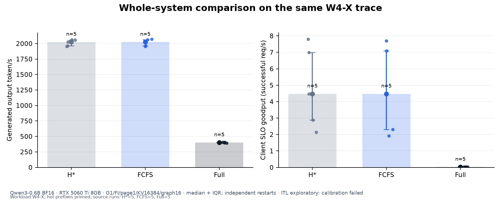

E06，同一绝对到达率、每次1000请求。H*为官方固定提交加共有正确性补丁；不是原样上游。误差线是运行间IQR。 [逐run绘图数据](report/figures/F1-throughput-source.json) · [SVG](report/figures/F1-throughput.svg)

### F2-tail-latency — Stage scheduling: tail latency and its timing boundaries

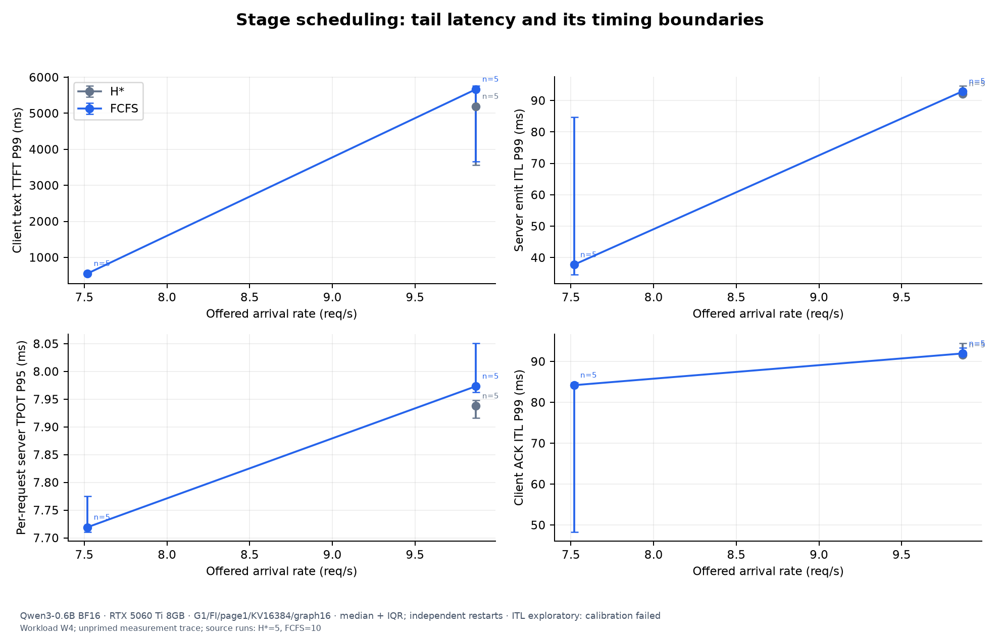

E02。TTFT-text从HTTP调用前开始；server ITL从既有D2H后的host emit采集；TPOT是每请求平均间隔后求分位数。ACK经逐请求与服务端token数量/序号对账。 [逐run绘图数据](report/figures/F2-tail-latency-source.json) · [SVG](report/figures/F2-tail-latency.svg)

### F2b-class-ttft — Stage scheduling: short and long request TTFT costs

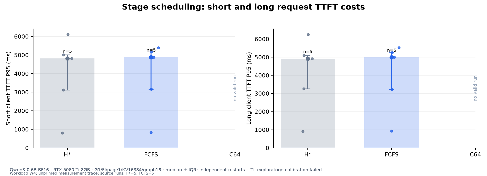

与F2相同的E02高rate，按实际trace class分别统计；long cohort不足1000，不以其P99作为主结论。 [逐run绘图数据](report/figures/F2b-class-ttft-source.json) · [SVG](report/figures/F2b-class-ttft.svg)

### F3-ablation — Legal ablations on a shared workload (E06)

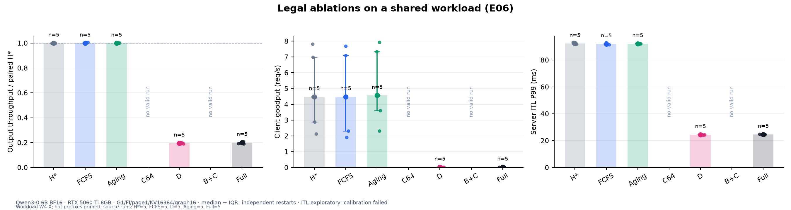

A0+C、A0+C+D尚未移植；A0+B和C0+D受依赖阻断，均未填数。B依赖A，D依赖C。H→S1000只表示默认实现净差异，不作A的独立归因。 [逐run绘图数据](report/figures/F3-ablation-source.json) · [SVG](report/figures/F3-ablation.svg)

### F4-cache — Cache competition: reuse, recomputation and throughput

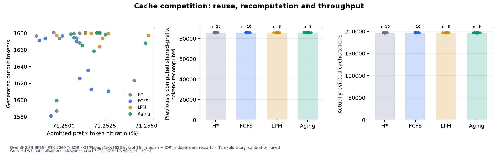

W3/B32，hot已prime、cold工作集32组。命中长度来自实际首次准入handle；重算只计此前已完整计算/prime的共享区，首次必要计算单列。散点关联不等于完整因果归因。 [逐run绘图数据](report/figures/F4-cache-source.json) · [SVG](report/figures/F4-cache.svg)

### F5-timeline — Dynamic-budget execution trace (paired seed 31727)

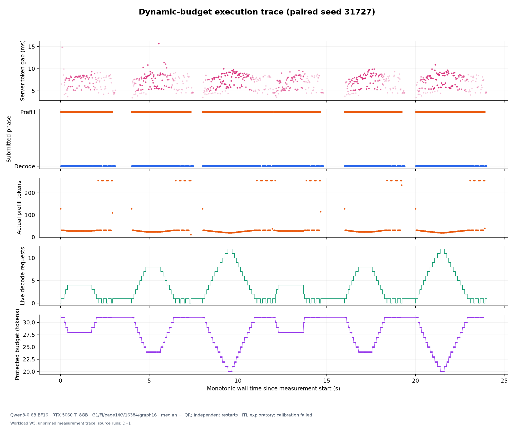

代表run按S1011 ITL P99最接近该配置运行中位数选定，同分取较小seed。固定展示前两个12秒周期，散点每4点展示1点；轨迹保留部分失败token，主统计只计校验成功请求并保留失败分母。 [逐run绘图数据](report/figures/F5-timeline-source.json) · [SVG](report/figures/F5-timeline.svg)

### F6-fairness — Cold fairness versus throughput

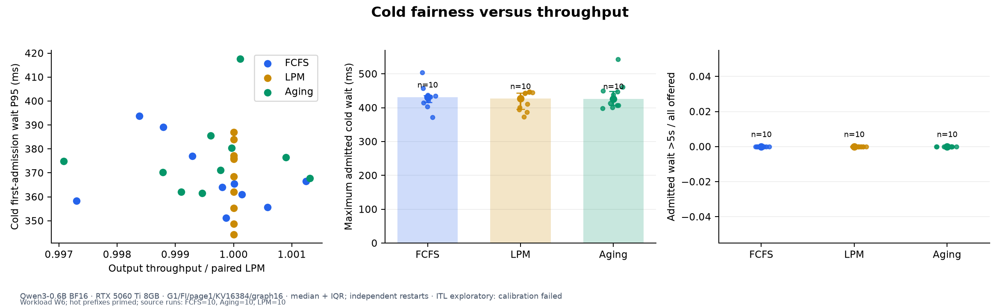

W6，hot/cold长度相同。cold每run约200，主报告P95/max与超5s比例，cold P99仅探索；未准入/超时另外列出。有限trace不能证明绝对无饥饿。 [逐run绘图数据](report/figures/F6-fairness-source.json) · [SVG](report/figures/F6-fairness.svg)

### F6b-wait-cdf — Admitted hot and cold waiting-time distributions

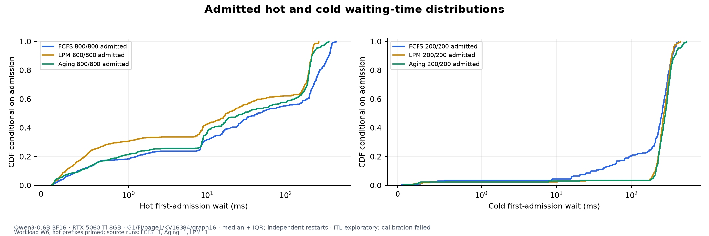

固定取三策略首个共有seed。分布含所有已准入请求（包括后来超时者），以已准入为条件；图例列准入/总请求数，逐类超时与删失下界见补充核算，不把未准入当作等待0。 [逐run绘图数据](report/figures/F6b-wait-cdf-source.json) · [SVG](report/figures/F6b-wait-cdf.svg)

### F7-dynamic — Dynamic budget versus both fixed64 and matched fixed24

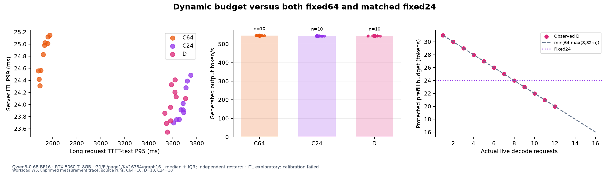

相同K=4、相同冻结W5波次与O256/O32。气泡面积表示输出吞吐。公式只在有Decode竞争的保护性Prefill执行；G1 running≤16且T32使floor8结构性不可达，本轮不验收该边界。 [逐run绘图数据](report/figures/F7-dynamic-source.json) · [SVG](report/figures/F7-dynamic.svg)

### F8-goodput — SLO goodput and failure rate at both frozen arrival rates

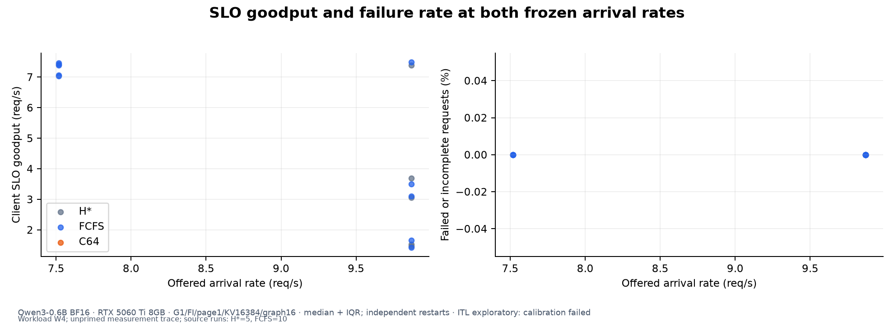

每点为一独立run，统一client TTFT短500ms/长2000ms及冻结E2E阈值；不同策略不各自调阈值。仅两个已测rate，不估计未测容量拐点。 [逐run绘图数据](report/figures/F8-goodput-source.json) · [SVG](report/figures/F8-goodput.svg)

### F9-memory — 8GB feasibility and memory headroom

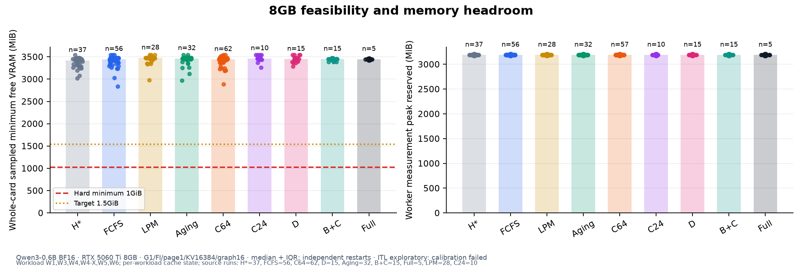

包含正式目录全部有遥测的尝试，包括污染、失败、中断及superseded版本。整卡free含启动/预热，来自0.5秒采样，不能证明不存在瞬时峰值；worker峰值只在有测量snapshot时可得，缺失不是0。allocated与reserved不能相加。 [逐run绘图数据](report/figures/F9-memory-source.json) · [SVG](report/figures/F9-memory.svg)

## 统计与失败解释

每次run独立计算分位数，重复间给中位数/IQR/MAD/min/max；误差线为IQR，95%区间以run为单位配对bootstrap10,000次。n=5区间不稳定；按冻结规则出现方向不稳、跨0或run内CV>5%时扩到10，保留前5次。cold每run约200，P99仅探索，公平性主读P95/max/超过5秒及未准入。完整统计见[逐次CSV](report/runs.csv)、[重复汇总](report/aggregates.json)、[全部配对CI](report/paired-ci.json)与[主对照CI](report/primary-comparisons.json)。

H→S1000包含默认实现的全部净差异；A没有独立关闭开关，A-ISO未实现。B依赖A，D依赖C，不能把四项当2^4独立因子。Full去B与去D只有在同W4-X trace下做条件比较。无V0010/V0011不估计A×C，不以naive cache伪造A0。

原样上游终态错误、CUDA编译错误、HTTP keepalive错误、跨形状数值分歧、pilot积压与所有正式失败均在错误台账中。W5的6秒pilot积压未并入正式；正式统一12秒周期，I/O长度保持不变。没有稳定改善的点不写简历收益。

## 覆盖、补充核算及未测项

| 实验 | 配置 | 总尝试 | 已尝试seed | 完成seed | 入选seed |
| --- | --- | --- | --- | --- | --- |
| E02 | H* | 6 | 5 | 5 | 5 |
| E02 | FCFS | 6 | 5 | 5 | 5 |
| E02 | C64 | 20 | 5 | 5 | 0 |
| E03 | FCFS | 11 | 10 | 10 | 10 |
| E03 | LPM | 11 | 10 | 10 | 10 |
| E03 | Aging | 10 | 10 | 10 | 10 |
| E04 | H* | 16 | 10 | 10 | 10 |
| E04 | FCFS | 19 | 10 | 10 | 10 |
| E04 | LPM | 17 | 10 | 10 | 8 |
| E04 | Aging | 17 | 10 | 10 | 9 |
| E05 | C64 | 12 | 10 | 10 | 10 |
| E05 | C24 | 10 | 10 | 10 | 10 |
| E05 | D | 10 | 10 | 10 | 10 |
| E01 | H* | 10 | 10 | 10 | 10 |
| E01 | FCFS | 10 | 10 | 10 | 10 |
| E02-low | FCFS | 5 | 5 | 5 | 5 |
| E02-low | C64 | 15 | 5 | 5 | 0 |
| E06 | H* | 5 | 5 | 5 | 5 |
| E06 | FCFS | 5 | 5 | 5 | 5 |
| E06 | Aging | 5 | 5 | 5 | 5 |
| E06 | C64 | 15 | 5 | 5 | 0 |
| E06 | D | 5 | 5 | 5 | 5 |
| E06 | B+C | 15 | 5 | 5 | 0 |
| E06 | Full | 5 | 5 | 5 | 5 |

完成seed与通过质量检查的seed是不同口径；不足5个入选seed明确限制对应对照。失败或超时不会因性能慢而被丢弃。全部错误和失败验收见[完整台账](report/error-ledger.json)。

### 同一配对下的收益与代价

| 实验/条件对照 | 指标 | n | 参考/候选中位数 | 改善率/95%配对CI |
| --- | --- | --- | --- | --- |
| E03 LPM→Aging | output_tok_s | 10 | 1556.150 / 1555.547 | -0.03% [-0.09,+0.04]% |
| E03 LPM→Aging | goodput_req_s | 10 | 48.554 / 48.399 | -0.27% [-0.66,-0.06]% |
| E03 LPM→Aging | itl_server_ms_p99 | 10 | 121.980 / 122.016 | -0.06% [-10.71,+5.60]% |
| E03 LPM→Aging | cold_wait_ms_p95 | 10 | 372.113 / 373.052 | -1.89% [-5.94,+2.06]% |
| E03 LPM→Aging | prefix_token_hit_ratio | 10 | 0.713 / 0.713 | -0.00% [-0.00,-0.00]% |
| E03 LPM→Aging | scheduler_us_mean | 10 | 87.452 / 88.086 | -2.17% [-5.76,+1.80]% |
| E04 FCFS→LPM | output_tok_s | 8 | 1652.831 / 1678.465 | +1.46% [-0.07,+4.12]% |
| E04 FCFS→LPM | goodput_req_s | 8 | 37.948 / 52.092 | +35.01% [+2.23,+134.86]% |
| E04 FCFS→LPM | itl_server_ms_p99 | 8 | 75.012 / 122.485 | -65.73% [-77.13,-51.74]% |
| E04 FCFS→LPM | cold_wait_ms_p95 | 8 | 662.142 / 421.864 | +26.47% [-3.62,+57.96]% |
| E04 FCFS→LPM | prefix_token_hit_ratio | 8 | 0.713 / 0.713 | +0.00% [+0.00,+0.00]% |
| E04 FCFS→LPM | scheduler_us_mean | 8 | 80.826 / 89.251 | -8.97% [-14.72,+1.64]% |
| E05 C64→D | output_tok_s | 10 | 545.471 / 543.676 | -0.33% [-0.34,-0.31]% |
| E05 C64→D | goodput_req_s | 10 | 2.356 / 1.206 | -49.22% [-49.42,-48.40]% |
| E05 C64→D | itl_server_ms_p99 | 10 | 24.904 / 24.026 | +3.21% [+2.51,+4.05]% |
| E05 C64→D | long_ttft_text_ms_p95 | 10 | 2527.052 / 3585.451 | -42.55% [-43.49,-41.30]% |
| E05 C64→D | prefix_token_hit_ratio | 10 | 0.000 / 0.000 | -3.22% [-7.65,-1.92]% |
| E05 C64→D | scheduler_us_mean | 10 | 27.859 / 28.410 | -2.34% [-4.59,+2.11]% |
| E05 C24→D | output_tok_s | 10 | 543.600 / 543.676 | +0.01% [-0.00,+0.04]% |
| E05 C24→D | goodput_req_s | 10 | 0.964 / 1.206 | +24.18% [+22.61,+26.43]% |
| E05 C24→D | itl_server_ms_p99 | 10 | 23.911 / 24.026 | +0.76% [-1.45,+1.10]% |
| E05 C24→D | long_ttft_text_ms_p95 | 10 | 3686.127 / 3585.451 | +2.78% [+1.95,+3.26]% |
| E05 C24→D | prefix_token_hit_ratio | 10 | 0.000 / 0.000 | +0.81% [-3.22,+3.59]% |
| E05 C24→D | scheduler_us_mean | 10 | 28.327 / 28.410 | +1.50% [-1.00,+3.22]% |
| E06 H*→Full | output_tok_s | 5 | 2025.769 / 402.081 | -79.90% [-80.95,-79.20]% |
| E06 H*→Full | goodput_req_s | 5 | 4.479 / 0.023 | -99.49% [-99.72,-98.94]% |
| E06 H*→Full | itl_server_ms_p99 | 5 | 92.276 / 24.691 | +73.23% [+73.09,+73.91]% |
| E06 H*→Full | long_ttft_text_ms_p95 | 5 | 2337.425 / 114165.029 | -4762.98% [-14783.40,-3547.85]% |
| E06 H*→Full | prefix_token_hit_ratio | 5 | 0.049 / 0.049 | -0.62% [-1.16,+0.27]% |
| E06 H*→Full | scheduler_us_mean | 5 | 27.544 / 54.240 | -100.64% [-118.12,-88.35]% |
| E06 D→Full | output_tok_s | 5 | 393.775 / 402.081 | +1.14% [-0.00,+6.35]% |
| E06 D→Full | goodput_req_s | 5 | 0.023 / 0.023 | -0.00% [-0.00,+20.00]% |
| E06 D→Full | itl_server_ms_p99 | 5 | 24.425 / 24.691 | -1.26% [-2.61,+1.79]% |
| E06 D→Full | long_ttft_text_ms_p95 | 5 | 113899.198 / 114165.029 | -0.23% [-1.27,+1.03]% |
| E06 D→Full | prefix_token_hit_ratio | 5 | 0.048 / 0.049 | +2.64% [+1.06,+3.82]% |
| E06 D→Full | failed | 5 | 586.000 / 576.000 | +0.70% [+0.00,+4.27]% |
| E06 D→Full | scheduler_us_mean | 5 | 52.055 / 54.240 | -4.20% [-8.06,-1.32]% |

ITL均为探索性；吞吐/命中率/Goodput按越大越好，等待/失败数/CPU耗时按越小越好计算改善。参考值为0时比值未定义，绝对失败数仍完整保留在逐run与补充核算中；不能把未定义比值解释成没有失败差异。该表不是多重比较校正后的显著性筛选。

#### E02：阶段调度

没有至少5对且参考指标非零的同trace入选记录，不能估计该对照的配对改善。实际失败、污染和样本数见覆盖表及台账。

#### E03：Aging公平性

- output_tok_s：1556.150→1555.547，10对，改善率中位数-0.03%，95%配对区间[-0.09,+0.04]%；区间跨0，改善方向不稳定。
- itl_server_ms_p99：121.980→122.016，10对，改善率中位数-0.06%，95%配对区间[-10.71,+5.60]%；探索性观察；全局尾延迟校准失败，不能升级为已验证收益。
- cold_wait_ms_p95：372.113→373.052，10对，改善率中位数-1.89%，95%配对区间[-5.94,+2.06]%；区间跨0，改善方向不稳定。
- prefix_token_hit_ratio：0.713→0.713，10对，改善率中位数-0.00%，95%配对区间[-0.00,-0.00]%；区间支持退化。

等待分布包含所有已准入请求；未准入是删失，不以成功子集或有限trace证明绝对无饥饿。

#### E04：Prefix复用

- output_tok_s：1652.831→1678.465，8对，改善率中位数+1.46%，95%配对区间[-0.07,+4.12]%；区间跨0，改善方向不稳定。
- itl_server_ms_p99：75.012→122.485，8对，改善率中位数-65.73%，95%配对区间[-77.13,-51.74]%；探索性观察；全局尾延迟校准失败，不能升级为已验证收益。
- cold_wait_ms_p95：662.142→421.864，8对，改善率中位数+26.47%，95%配对区间[-3.62,+57.96]%；区间跨0，改善方向不稳定。
- prefix_token_hit_ratio：0.713→0.713，8对，改善率中位数+0.00%，95%配对区间[+0.00,+0.00]%；区间支持该测量条件下改善。

真实cached_len、重算与淘汰计数用来解释复用机制；命中与吞吐的相关性不等于全部差异的因果归因。

#### E05：动态预算相对固定64

- output_tok_s：545.471→543.676，10对，改善率中位数-0.33%，95%配对区间[-0.34,-0.31]%；区间支持退化。
- itl_server_ms_p99：24.904→24.026，10对，改善率中位数+3.21%，95%配对区间[+2.51,+4.05]%；探索性观察；全局尾延迟校准失败，不能升级为已验证收益。
- long_ttft_text_ms_p95：2527.052→3585.451，10对，改善率中位数-42.55%，95%配对区间[-43.49,-41.30]%；区间支持退化。
- prefix_token_hit_ratio：0.000→0.000，10对，改善率中位数-3.22%，95%配对区间[-7.65,-1.92]%；区间支持退化。

必须同时读取两个固定预算对照及长TTFT/吞吐代价。当前G1 running≤16、T=32，公式预算至少16，floor8在该资源档位结构性不可达；不宣称其GPU边界已验收。即使观测ITL区间在0以上，未通过的校准仍限制动态预算收益结论。

#### E05：动态预算相对调优固定24

- output_tok_s：543.600→543.676，10对，改善率中位数+0.01%，95%配对区间[-0.00,+0.04]%；区间跨0，改善方向不稳定。
- itl_server_ms_p99：23.911→24.026，10对，改善率中位数+0.76%，95%配对区间[-1.45,+1.10]%；探索性观察；全局尾延迟校准失败，不能升级为已验证收益。
- long_ttft_text_ms_p95：3686.127→3585.451，10对，改善率中位数+2.78%，95%配对区间[+1.95,+3.26]%；区间支持该测量条件下改善。
- prefix_token_hit_ratio：0.000→0.000，10对，改善率中位数+0.81%，95%配对区间[-3.22,+3.59]%；区间跨0，改善方向不稳定。

必须同时读取两个固定预算对照及长TTFT/吞吐代价。当前G1 running≤16、T=32，公式预算至少16，floor8在该资源档位结构性不可达；不宣称其GPU边界已验收。即使观测ITL区间在0以上，未通过的校准仍限制动态预算收益结论。

#### E06：整机净效果

- output_tok_s：2025.769→402.081，5对，改善率中位数-79.90%，95%配对区间[-80.95,-79.20]%；区间支持退化。
- itl_server_ms_p99：92.276→24.691，5对，改善率中位数+73.23%，95%配对区间[+73.09,+73.91]%；探索性观察；全局尾延迟校准失败，不能升级为已验证收益。
- long_ttft_text_ms_p95：2337.425→114165.029，5对，改善率中位数-4762.98%，95%配对区间[-14783.40,-3547.85]%；区间支持退化。
- prefix_token_hit_ratio：0.049→0.049，5对，改善率中位数-0.62%，95%配对区间[-1.16,+0.27]%；区间跨0，改善方向不稳定。

H*包含共有正确性补丁，Full差异只表示固定混合负载上的净效果；不把该百分比拆成四个独立优化相加。

**自然输出语义检查未通过：** 2+2在H*/S1000/S1111均生成“2”而不是“4”；相同input IDs的HF BF16/SDPA参考也输出“2”，四个自然问题完整文本与mini一致。其余Paris/gato通过，星期续写仅作输出一致性检查。逐token一致、参考一致、终态完整与语义正确是不同验收。证据见[自然问题语义审计](report/natural-semantic-audit.json)和[HF原始参考](preflight/natural-hf-reference.json)，不能写“全部正确性通过”。本轮未修改权重、精度、prompt或输出长度去掩盖问题；它限制质量结论。

首个C64正式尝试940成功/60超时后触发Abort-overlap页重复归还；真实CPU状态机在H/S均复现。共有修正只在Abort释放后将对象加入现有已释放结果集合，过滤其尚未消费的结果，不新增正常token热路径操作。旧正式数据和旧源码快照保留并明确标记superseded；最终比较统一采用修复后的H*/S版本。

[补充核算](report/supplemental-accounting.json)逐run列出请求输出预算、服务端实际生成、客户端ACK、成功生成及失败/部分生成量，按类列出未准入的删失等待下界、Abort与资源状态，另给固定0.5×/1×/2×TTFT SLO敏感性。原始主指标与入选规则未改变。缓存占用补充核算将权重截在实际client终止边界，避免测量后Abort drain的负时间权重。

[合法条件交互](report/conditional-interactions.json)只估计B×C|A与B×D|A,C的配对log ratio。A0隔离实现、A×C、非法B无A/D无C均未执行、不填预测值。W2无复用完整GPU sweep、W5低KV/G0资源压力扫、A-ISO CPU微基准与D floor8边界不属于本轮已测正式矩阵，不宣称已完成。

Cold表示该run测量trace未prime；warmup使用独立prompt但仍会留下少量公共前缀，所以不宣称测量起点radix树绝对为空。Warm表示W3/W6/W4-X按冻结prime文件预热。W6在任何E03测量前修正cold-first，每个B32先放该burst的cold配额；旧pilot与新pilot以及未受影响W4字节hash均保留。

简历表述见[证据审核](RESUME_EVIDENCE.md)，无稳定动态预算收益时按负结果报告。报告状态与当前运行记录见[PROGRESS.json](PROGRESS.json)。
